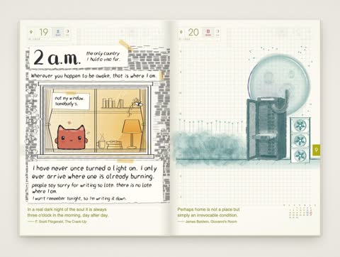

[← Back to gallery](../browse/stories.en.md) · [简体中文](2103143902723096848.md)

# Travel Journal Writing and Page Turns

**[arni · @arni0x9053](https://x.com/arni0x9053)** · Narrative films · 94s

> Discovery pool · Source verified; catalog details being completed.

**[▶ Open gallery to play](https://guanmo-ai.github.io/awesome-ai-motion/?lang=en#case-2103143902723096848)** · [Original post](https://x.com/arni0x9053/status/2103143902723096848)

Click the cover to open the gallery and play.

Calligraphy, illustrations and changing layouts form a travel journal drawn in code.

No public prompt has been verified. [View the original post](https://x.com/arni0x9053/status/2103143902723096848)

Bookmarks — · Likes — · Views —

## Source record

- Original post: [@arni0x9053](https://x.com/arni0x9053/status/2103143902723096848) · 2026-09-24T15:25:55+00:00
- Model attribution: Claude Opus 5.5 · [Creator’s statement](https://x.com/arni0x9053/status/2103143902723096848)
- Prompt lookup: [Creator post](https://x.com/arni0x9053/status/2103143902723096848) · 2026-11-03 09:18 UTC
- Cover source: [Original cover source](https://x.com/arni0x9053/status/2103143902723096848) · 18.87s
- Metrics snapshot: [Original X post](https://x.com/arni0x9053/status/2103143902723096848) · 2026-11-03 08:42 UTC
- Gallery video source: [Original post media record](https://x.com/arni0x9053/status/2103143902723096848) · 2026-11-03 09:18 UTC · Post/media correspondence and media response checked; external reference, no re-upload

Model attribution is based on creator statements. Prompts have not been independently rerun; sound and visuals have not received a uniform quality rating. Videos reference original post media, not our uploads; redistribution permission has not been verified.
