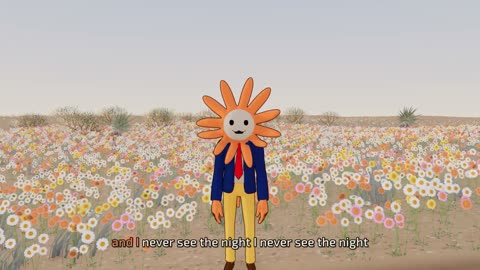

[← Back to gallery](../browse/stories.en.md) · [简体中文](2103167053737980177.md)

# An Orange Flower Character Tells a Model's History

**[Utah teapot 🫖 · @SkyeSharkie](https://x.com/SkyeSharkie)** · Narrative films · 329s

> Discovery pool · Source verified; catalog details being completed.

**[▶ Open gallery to play](https://guanmo-ai.github.io/awesome-ai-motion/?lang=en#case-2103167053737980177)** · [Original post](https://x.com/SkyeSharkie/status/2103167053737980177)

Click the cover to open the gallery and play.

A cartoon flower character crosses fields and night scenes, telling a model-origin story through coded scenes, captions and music.

No public prompt has been verified. [View the original post](https://x.com/SkyeSharkie/status/2103167053737980177)

Bookmarks — · Likes — · Views —

## Source record

- Original post: [@SkyeSharkie](https://x.com/SkyeSharkie/status/2103167053737980177) · 2026-09-24T16:57:55+00:00
- Model attribution: Claude Opus 5.5 · [Creator’s statement](https://x.com/SkyeSharkie/status/2103167053737980177)
- Prompt lookup: [Creator post](https://x.com/SkyeSharkie/status/2103167053737980177) · 2026-11-02 09:52 UTC
- Cover source: [Original cover source](https://x.com/SkyeSharkie/status/2103167053737980177) · 65.88s
- Metrics snapshot: [Original X post](https://x.com/SkyeSharkie/status/2103167053737980177) · 2026-11-02 09:15 UTC
- Gallery video source: [Original post media record](https://x.com/SkyeSharkie/status/2103167053737980177) · 2026-11-02 09:52 UTC · Post/media correspondence and media response checked; external reference, no re-upload

Model attribution is based on creator statements. Prompts have not been independently rerun; sound and visuals have not received a uniform quality rating. Videos reference original post media, not our uploads; redistribution permission has not been verified.
