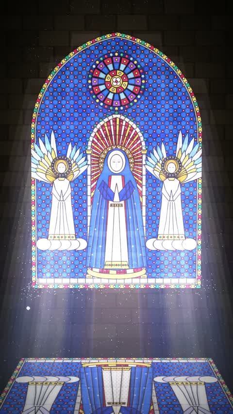

[← Back to gallery](../browse/stories.en.md) · [简体中文](2103167623303397647.md)

# White Space and Stained-Glass Light

**[AGIおやZ · @AGIOyaZ](https://x.com/AGIOyaZ)** · Narrative films · 37s

> Discovery pool · Source verified; catalog details being completed.

**[▶ Open gallery to play](https://guanmo-ai.github.io/awesome-ai-motion/?lang=en#case-2103167623303397647)** · [Original post](https://x.com/AGIOyaZ/status/2103167623303397647)

Click the cover to open the gallery and play.

Blocks cover a window, then fall away in sequence to restore stained-glass light.

The creator has shared instructions; this catalog links to the source without redistributing the full text or translation. [Read the creator’s original](https://x.com/AGIOyaZ/status/2103167623303397647)

Bookmarks — · Likes — · Views —

## Source record

- Original post: [@AGIOyaZ](https://x.com/AGIOyaZ/status/2103167623303397647) · 2026-09-24T17:00:11+00:00
- Model attribution: Claude Opus 5.5 · [Creator’s statement](https://x.com/AGIOyaZ/status/2103167623303397647)
- Prompt source: [Creator post](https://x.com/AGIOyaZ/status/2103167623303397647) · 2026-11-03 09:18 UTC
- Cover source: [Original cover source](https://x.com/AGIOyaZ/status/2103167623303397647) · 25.94s
- Metrics snapshot: [Original X post](https://x.com/AGIOyaZ/status/2103167623303397647) · 2026-11-03 08:42 UTC
- Gallery video source: [Original post media record](https://x.com/AGIOyaZ/status/2103167623303397647) · 2026-11-03 09:18 UTC · Post/media correspondence and media response checked; external reference, no re-upload

Model attribution is based on creator statements. Prompts have not been independently rerun; sound and visuals have not received a uniform quality rating. Videos reference original post media, not our uploads; redistribution permission has not been verified.
