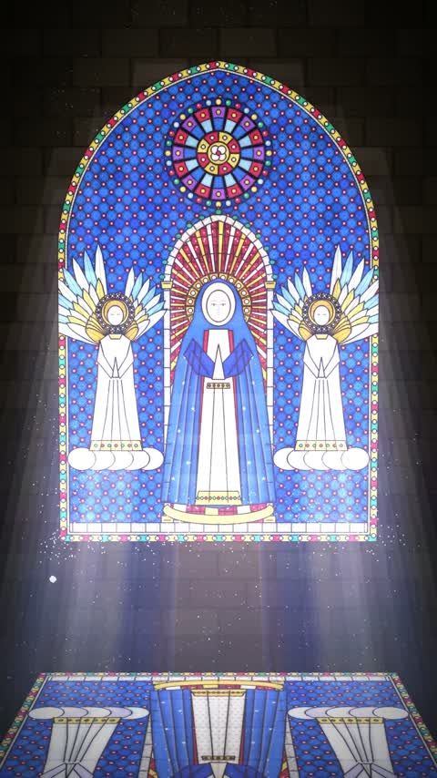

[← 返回图库](../browse/stories.md) · [English](2103167623303397647.en.md)

# 余白与彩色玻璃的光影短片

**[AGIおやZ · @AGIOyaZ](https://x.com/AGIOyaZ)** · 叙事短片 · 37s

> 发现池 · 来源已核对，编目资料待完善。

**[▶ 打开画廊播放](https://guanmo-ai.github.io/awesome-ai-motion/#case-2103167623303397647)** · [作者原帖](https://x.com/AGIOyaZ/status/2103167623303397647)

点击封面打开画廊播放。

方块逐渐遮住窗户，再连锁散开，让彩色玻璃的光重新进入空间。

作者已公开指令；本站仅提供原帖入口，不再分发全文或译文。 [查看作者原文](https://x.com/AGIOyaZ/status/2103167623303397647)

收藏 — · 点赞 — · 浏览 —

## 来源记录

- 作品原帖: [@AGIOyaZ](https://x.com/AGIOyaZ/status/2103167623303397647) · 2026-09-24T17:00:11+00:00
- 模型归因: Claude Opus 5.5 · [作者说明](https://x.com/AGIOyaZ/status/2103167623303397647)
- 提示词出处: [作者原帖](https://x.com/AGIOyaZ/status/2103167623303397647) · 2026-11-03 09:18 UTC
- 封面来源: [原帖封面来源](https://x.com/AGIOyaZ/status/2103167623303397647) · 25.94s
- 互动快照: [X 原帖](https://x.com/AGIOyaZ/status/2103167623303397647) · 2026-11-03 08:42 UTC
- 画廊原视频: [原帖媒体记录](https://x.com/AGIOyaZ/status/2103167623303397647) · 2026-11-03 09:18 UTC · 已核对原帖媒体对应与媒体响应；外部引用，不重新上传

模型依据来自作者自述，未独立重跑提示词，也未对音画作统一质量评级。视频引用作者原帖媒体，未由本站重新上传，转载许可未确认。
