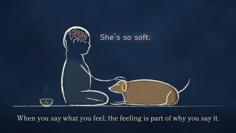

[← Back to gallery](../browse/education.en.md) · [简体中文](2103170102107500792.md)

# A Line-Drawn Film on Consciousness and Substrate

**[Rife · @RifeWithKaiju](https://x.com/RifeWithKaiju)** · Education & explainers · 140s

> Discovery pool · Source verified; catalog details being completed.

**[▶ Open gallery to play](https://guanmo-ai.github.io/awesome-ai-motion/?lang=en#case-2103170102107500792)** · [Original post](https://x.com/RifeWithKaiju/status/2103170102107500792)

Click the cover to open the gallery and play.

Line-drawn people, animals and captions illustrate the creator's argument about consciousness without treating it as a verified conclusion.

No public prompt has been verified. [View the original post](https://x.com/RifeWithKaiju/status/2103170102107500792)

Bookmarks — · Likes — · Views —

## Source record

- Original post: [@RifeWithKaiju](https://x.com/RifeWithKaiju/status/2103170102107500792) · 2026-09-24T17:10:02+00:00
- Model attribution: Claude Opus 5.5 · [Creator’s statement](https://x.com/RifeWithKaiju/status/2103170102107500792)
- Prompt lookup: [Creator post](https://x.com/RifeWithKaiju/status/2103170102107500792) · 2026-11-02 15:38 UTC
- Cover source: [Original cover source](https://x.com/RifeWithKaiju/status/2103170102107500792) · 27.93s
- Metrics snapshot: [Original X post](https://x.com/RifeWithKaiju/status/2103170102107500792) · 2026-11-02 15:05 UTC
- Gallery video source: [Original post media record](https://x.com/RifeWithKaiju/status/2103170102107500792) · 2026-11-02 15:38 UTC · Post/media correspondence and media response checked; external reference, no re-upload

Model attribution is based on creator statements. Prompts have not been independently rerun; sound and visuals have not received a uniform quality rating. Videos reference original post media, not our uploads; redistribution permission has not been verified.
