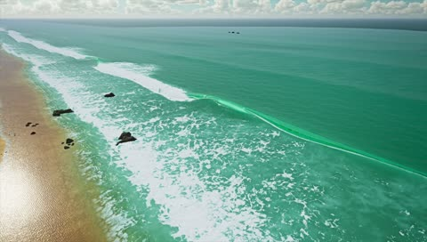

[← Back to gallery](../browse/motion.en.md) · [简体中文](2103195160435691990.md)

# Procedural Shore Waves from Above

**[Brian Gruber · @gruberbuilds](https://x.com/gruberbuilds)** · Motion design · 40s

> Discovery pool · Source verified; catalog details being completed.

**[▶ Open gallery to play](https://guanmo-ai.github.io/awesome-ai-motion/?lang=en#case-2103195160435691990)** · [Original post](https://x.com/gruberbuilds/status/2103195160435691990)

Click the cover to open the gallery and play.

Foam advances and recedes along the shore in a real-time water study.

No public prompt has been verified. [View the original post](https://x.com/gruberbuilds/status/2103195160435691990)

Bookmarks — · Likes — · Views —

## Source record

- Original post: [@gruberbuilds](https://x.com/gruberbuilds/status/2103195160435691990) · 2026-09-24T18:49:36+00:00
- Model attribution: Claude Opus 5.5 · [Creator’s statement](https://x.com/gruberbuilds/status/2103195160435691990)
- Prompt lookup: [Creator post](https://x.com/gruberbuilds/status/2103195160435691990) · 2026-11-03 09:18 UTC
- Cover source: [Original cover source](https://x.com/gruberbuilds/status/2103195160435691990) · 7.92s
- Metrics snapshot: [Original X post](https://x.com/gruberbuilds/status/2103195160435691990) · 2026-11-03 08:42 UTC
- Gallery video source: [Original post media record](https://x.com/gruberbuilds/status/2103195160435691990) · 2026-11-03 09:18 UTC · Post/media correspondence and media response checked; external reference, no re-upload

Model attribution is based on creator statements. Prompts have not been independently rerun; sound and visuals have not received a uniform quality rating. Videos reference original post media, not our uploads; redistribution permission has not been verified.
