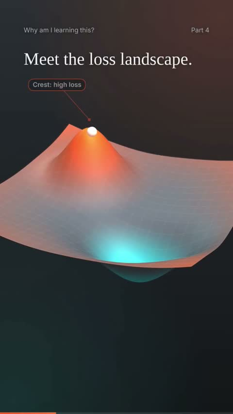

[← Back to gallery](../browse/education.en.md) · [简体中文](2103195903012032809.md)

# A Ball Through the Loss Landscape

**[Anirban Das · @anirockshady](https://x.com/anirockshady)** · Education & explainers · 57s

> Discovery pool · Source verified; catalog details being completed.

**[▶ Open gallery to play](https://guanmo-ai.github.io/awesome-ai-motion/?lang=en#case-2103195903012032809)** · [Original post](https://x.com/anirockshady/status/2103195903012032809)

Click the cover to open the gallery and play.

A 3D surface, target points and paths visualize a learning landscape.

No public prompt has been verified. [View the original post](https://x.com/anirockshady/status/2103195903012032809)

Bookmarks — · Likes — · Views —

## Source record

- Original post: [@anirockshady](https://x.com/anirockshady/status/2103195903012032809) · 2026-09-24T18:52:33+00:00
- Model attribution: Claude Opus 5.5 · [Creator’s statement](https://x.com/anirockshady/status/2103195903012032809)
- Prompt lookup: [Creator post](https://x.com/anirockshady/status/2103195903012032809) · 2026-11-03 09:18 UTC
- Cover source: [Original cover source](https://x.com/anirockshady/status/2103195903012032809) · 11.39s
- Metrics snapshot: [Original X post](https://x.com/anirockshady/status/2103195903012032809) · 2026-11-03 08:42 UTC
- Gallery video source: [Original post media record](https://x.com/anirockshady/status/2103195903012032809) · 2026-11-03 09:18 UTC · Post/media correspondence and media response checked; external reference, no re-upload

Model attribution is based on creator statements. Prompts have not been independently rerun; sound and visuals have not received a uniform quality rating. Videos reference original post media, not our uploads; redistribution permission has not been verified.
