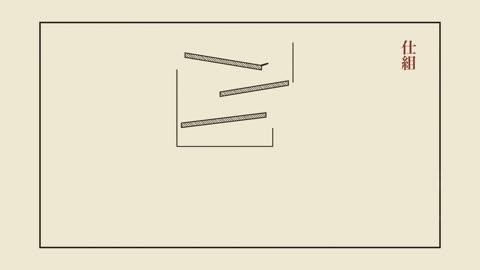

[← Back to gallery](../browse/stories.en.md) · [简体中文](2103242773386215652.md)

# A Portfolio Becomes an Illustrated Book

**[Daniel White · @dwhitedesign](https://x.com/dwhitedesign)** · Narrative films · 45s

> Discovery pool · Source verified; catalog details being completed.

**[▶ Open gallery to play](https://guanmo-ai.github.io/awesome-ai-motion/?lang=en#case-2103242773386215652)** · [Original post](https://x.com/dwhitedesign/status/2103242773386215652)

Click the cover to open the gallery and play.

Line drawings, pages and chapter scenes turn a portfolio into an illustrated-book film.

No public prompt has been verified. [View the original post](https://x.com/dwhitedesign/status/2103242773386215652)

Bookmarks — · Likes — · Views —

## Source record

- Original post: [@dwhitedesign](https://x.com/dwhitedesign/status/2103242773386215652) · 2026-09-24T21:58:48+00:00
- Model attribution: Claude Opus 5.5 · [Creator’s statement](https://x.com/dwhitedesign/status/2103242773386215652)
- Prompt lookup: [Creator post](https://x.com/dwhitedesign/status/2103242773386215652) · 2026-11-02 15:38 UTC
- Cover source: [Original cover source](https://x.com/dwhitedesign/status/2103242773386215652) · 8.96s
- Metrics snapshot: [Original X post](https://x.com/dwhitedesign/status/2103242773386215652) · 2026-11-02 15:08 UTC
- Gallery video source: [Original post media record](https://x.com/dwhitedesign/status/2103242773386215652) · 2026-11-02 15:38 UTC · Post/media correspondence and media response checked; external reference, no re-upload

Model attribution is based on creator statements. Prompts have not been independently rerun; sound and visuals have not received a uniform quality rating. Videos reference original post media, not our uploads; redistribution permission has not been verified.
