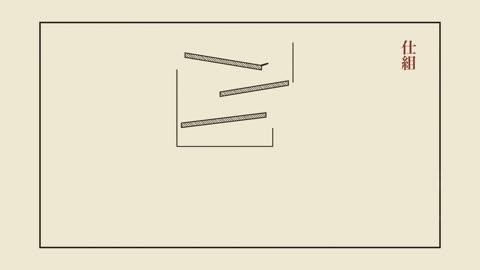

[← 返回图库](../browse/stories.md) · [English](2103242773386215652.en.md)

# 个人作品集变成插画书

**[Daniel White · @dwhitedesign](https://x.com/dwhitedesign)** · 叙事短片 · 45s

> 发现池 · 来源已核对，编目资料待完善。

**[▶ 打开画廊播放](https://guanmo-ai.github.io/awesome-ai-motion/#case-2103242773386215652)** · [作者原帖](https://x.com/dwhitedesign/status/2103242773386215652)

点击封面打开画廊播放。

线描、书页与章节画面组成个人作品集的插画书短片。

未取得作者公开提示词。 [查看作者原帖](https://x.com/dwhitedesign/status/2103242773386215652)

收藏 — · 点赞 — · 浏览 —

## 来源记录

- 作品原帖: [@dwhitedesign](https://x.com/dwhitedesign/status/2103242773386215652) · 2026-09-24T21:58:48+00:00
- 模型归因: Claude Opus 5.5 · [作者说明](https://x.com/dwhitedesign/status/2103242773386215652)
- 提示词查阅记录: [作者原帖](https://x.com/dwhitedesign/status/2103242773386215652) · 2026-11-02 15:38 UTC
- 封面来源: [原帖封面来源](https://x.com/dwhitedesign/status/2103242773386215652) · 8.96s
- 互动快照: [X 原帖](https://x.com/dwhitedesign/status/2103242773386215652) · 2026-11-02 15:08 UTC
- 画廊原视频: [原帖媒体记录](https://x.com/dwhitedesign/status/2103242773386215652) · 2026-11-02 15:38 UTC · 已核对原帖媒体对应与媒体响应；外部引用，不重新上传

模型依据来自作者自述，未独立重跑提示词，也未对音画作统一质量评级。视频引用作者原帖媒体，未由本站重新上传，转载许可未确认。
