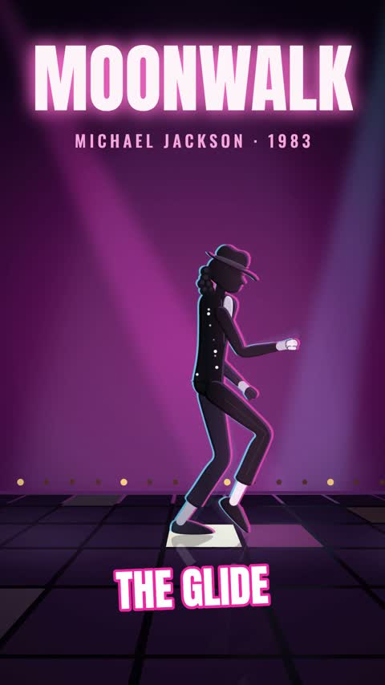

[← Back to gallery](../browse/characters.en.md) · [简体中文](2103257988895035448.md)

# Coded Character Moonwalk

**[Ato Augustine · @otatechie](https://x.com/otatechie)** · Pixel art & characters · 15s

> Discovery pool · Source verified; catalog details being completed.

**[▶ Open gallery to play](https://guanmo-ai.github.io/awesome-ai-motion/?lang=en#case-2103257988895035448)** · [Original post](https://x.com/otatechie/status/2103257988895035448)

Click the cover to open the gallery and play.

A simplified 3D character performs a moonwalk through gliding steps and camera cuts.

No public prompt has been verified. [View the original post](https://x.com/otatechie/status/2103257988895035448)

Bookmarks — · Likes — · Views —

## Source record

- Original post: [@otatechie](https://x.com/otatechie/status/2103257988895035448) · 2026-09-24T22:59:15+00:00
- Model attribution: Claude Opus 5.5 · [Creator’s statement](https://x.com/otatechie/status/2103257988895035448)
- Prompt lookup: [Creator post](https://x.com/otatechie/status/2103257988895035448) · 2026-11-03 09:18 UTC
- Cover source: [Original cover source](https://x.com/otatechie/status/2103257988895035448) · 3.02s
- Metrics snapshot: [Original X post](https://x.com/otatechie/status/2103257988895035448) · 2026-11-03 08:42 UTC
- Gallery video source: [Original post media record](https://x.com/otatechie/status/2103257988895035448) · 2026-11-03 09:18 UTC · Post/media correspondence and media response checked; external reference, no re-upload

Model attribution is based on creator statements. Prompts have not been independently rerun; sound and visuals have not received a uniform quality rating. Videos reference original post media, not our uploads; redistribution permission has not been verified.
