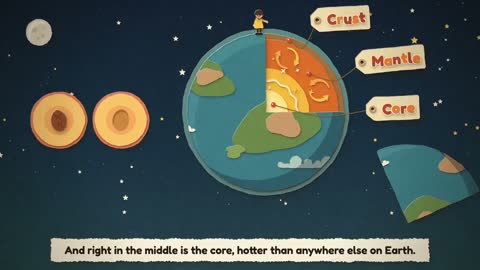

[← Back to gallery](../browse/education.en.md) · [简体中文](2103272493658353765.md)

# A Children's Explainer of Volcanoes

**[Nishanth PS · @nishanthps](https://x.com/nishanthps)** · Education & explainers · 195s

> Discovery pool · Source verified; catalog details being completed.

**[▶ Open gallery to play](https://guanmo-ai.github.io/awesome-ai-motion/?lang=en#case-2103272493658353765)** · [Original post](https://x.com/nishanthps/status/2103272493658353765)

Click the cover to open the gallery and play.

Earth sections, lava and cartoon labels present volcano structure and eruptions.

No public prompt has been verified. [View the original post](https://x.com/nishanthps/status/2103272493658353765)

Bookmarks — · Likes — · Views —

## Source record

- Original post: [@nishanthps](https://x.com/nishanthps/status/2103272493658353765) · 2026-09-24T23:56:54+00:00
- Model attribution: Claude Opus 5.5 · [Creator’s statement](https://x.com/nishanthps/status/2103272493658353765)
- Prompt lookup: [Creator post](https://x.com/nishanthps/status/2103272493658353765) · 2026-11-02 15:38 UTC
- Cover source: [Original cover source](https://x.com/nishanthps/status/2103272493658353765) · 38.96s
- Metrics snapshot: [Original X post](https://x.com/nishanthps/status/2103272493658353765) · 2026-11-02 15:08 UTC
- Gallery video source: [Original post media record](https://x.com/nishanthps/status/2103272493658353765) · 2026-11-02 15:38 UTC · Post/media correspondence and media response checked; external reference, no re-upload

Model attribution is based on creator statements. Prompts have not been independently rerun; sound and visuals have not received a uniform quality rating. Videos reference original post media, not our uploads; redistribution permission has not been verified.
