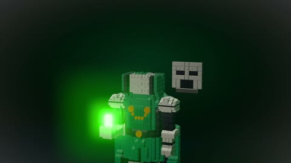

[← Back to gallery](../browse/characters.en.md) · [简体中文](2103280356371702076.md)

# Doctor Doom Brick Assembly

**[Samnang Aing · @SammmAing](https://x.com/SammmAing)** · Pixel art & characters · 57s

> Discovery pool · Source verified; catalog details being completed.

**[▶ Open gallery to play](https://guanmo-ai.github.io/awesome-ai-motion/?lang=en#case-2103280356371702076)** · [Original post](https://x.com/SammmAing/status/2103280356371702076)

Click the cover to open the gallery and play.

[Single-page brick-animation project](https://github.com/Sam1983Aing/doom-in-bricks) · [View the brick assembly online](https://sam1983aing.github.io/doom-in-bricks/)

Brick parts assemble layer by layer into a character model.

## Source & web pages

- **Direct source**：[Single-page brick-animation project](https://github.com/Sam1983Aing/doom-in-bricks) · No license specified
  A publicly readable unofficial character-brick demo with no overall license found; character and brand rights are not established.
  [Link source](https://x.com/SammmAing/status/2103280356371702076) · Link checked 2026-11-03 09:18 UTC
- **Public web page**：[View the brick assembly online](https://sam1983aing.github.io/doom-in-bricks/)
  [Link source](https://x.com/SammmAing/status/2103280356371702076) · Link checked 2026-11-03 09:18 UTC

No public prompt has been verified. [View the original post](https://x.com/SammmAing/status/2103280356371702076)

Bookmarks — · Likes — · Views —

## Source record

- Original post: [@SammmAing](https://x.com/SammmAing/status/2103280356371702076) · 2026-09-25T00:28:08+00:00
- Model attribution: Claude Opus 5.5 · [Creator’s statement](https://x.com/SammmAing/status/2103280356371702076)
- Prompt lookup: [Creator post](https://x.com/SammmAing/status/2103280356371702076) · 2026-11-03 09:18 UTC
- Cover source: [Original cover source](https://x.com/SammmAing/status/2103280356371702076) · 40.15s
- Metrics snapshot: [Original X post](https://x.com/SammmAing/status/2103280356371702076) · 2026-11-03 08:42 UTC
- Gallery video source: [Original post media record](https://x.com/SammmAing/status/2103280356371702076) · 2026-11-03 09:18 UTC · Post/media correspondence and media response checked; external reference, no re-upload

Model attribution is based on creator statements. Prompts have not been independently rerun; sound and visuals have not received a uniform quality rating. Videos reference original post media, not our uploads; redistribution permission has not been verified.
