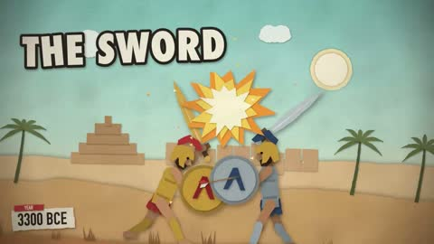

[← Back to gallery](../browse/education.en.md) · [简体中文](2103285921051545914.md)

# A Cartoon History from Swords to Drones

**[spicylemonade · @spicey\_lemonade](https://x.com/spicey_lemonade)** · Education & explainers · 82s

> Discovery pool · Source verified; catalog details being completed.

**[▶ Open gallery to play](https://guanmo-ai.github.io/awesome-ai-motion/?lang=en#case-2103285921051545914)** · [Original post](https://x.com/spicey_lemonade/status/2103285921051545914)

Click the cover to open the gallery and play.

Cartoon objects, figures and a timeline explain a history of changing weapons.

No public prompt has been verified. [View the original post](https://x.com/spicey_lemonade/status/2103285921051545914)

Bookmarks — · Likes — · Views —

## Source record

- Original post: [@spicey\_lemonade](https://x.com/spicey_lemonade/status/2103285921051545914) · 2026-09-25T00:50:15+00:00
- Model attribution: Claude Opus 5.5 · [Creator’s statement](https://x.com/spicey_lemonade/status/2103285921051545914)
- Prompt lookup: [Creator post](https://x.com/spicey_lemonade/status/2103285921051545914) · 2026-11-02 09:52 UTC
- Cover source: [Original cover source](https://x.com/spicey_lemonade/status/2103285921051545914) · 16.45s
- Metrics snapshot: [Original X post](https://x.com/spicey_lemonade/status/2103285921051545914) · 2026-11-02 09:19 UTC
- Gallery video source: [Original post media record](https://x.com/spicey_lemonade/status/2103285921051545914) · 2026-11-02 09:52 UTC · Post/media correspondence and media response checked; external reference, no re-upload

Model attribution is based on creator statements. Prompts have not been independently rerun; sound and visuals have not received a uniform quality rating. Videos reference original post media, not our uploads; redistribution permission has not been verified.
