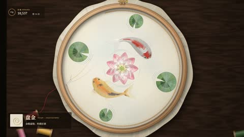

[← Back to gallery](../browse/motion.en.md) · [简体中文](2103308087319007283.md)

# Embroidered Koi Pattern Animation

**[nicekate · @nicekate8888](https://x.com/nicekate8888)** · Motion design · 60s

> Discovery pool · Source verified; catalog details being completed.

**[▶ Open gallery to play](https://guanmo-ai.github.io/awesome-ai-motion/?lang=en#case-2103308087319007283)** · [Original post](https://x.com/nicekate8888/status/2103308087319007283)

Click the cover to open the gallery and play.

Koi and lotus leaves emerge and move inside an embroidery hoop.

No public prompt has been verified. [View the original post](https://x.com/nicekate8888/status/2103308087319007283)

Bookmarks — · Likes — · Views —

## Source record

- Original post: [@nicekate8888](https://x.com/nicekate8888/status/2103308087319007283) · 2026-09-25T02:18:20+00:00
- Model attribution: Claude Opus 5.5 · [Creator’s statement](https://x.com/nicekate8888/status/2103308087319007283)
- Prompt lookup: [Creator post](https://x.com/nicekate8888/status/2103308087319007283) · 2026-11-03 09:18 UTC
- Cover source: [Original cover source](https://x.com/nicekate8888/status/2103308087319007283) · 42.04s
- Metrics snapshot: [Original X post](https://x.com/nicekate8888/status/2103308087319007283) · 2026-11-03 08:42 UTC
- Gallery video source: [Original post media record](https://x.com/nicekate8888/status/2103308087319007283) · 2026-11-03 09:18 UTC · Post/media correspondence and media response checked; external reference, no re-upload

Model attribution is based on creator statements. Prompts have not been independently rerun; sound and visuals have not received a uniform quality rating. Videos reference original post media, not our uploads; redistribution permission has not been verified.
