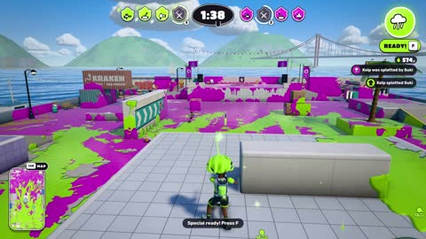

[← Back to gallery](../browse/interactive.en.md) · [简体中文](2103357848961036304.md)

# A 3D Arena Covered in Colorful Ink

**[Jayden Davis · @JaydenDavisNC](https://x.com/JaydenDavisNC)** · 3D & interactive · 148s

> Discovery pool · Source verified; catalog details being completed.

**[▶ Open gallery to play](https://guanmo-ai.github.io/awesome-ai-motion/?lang=en#case-2103357848961036304)** · [Original post](https://x.com/JaydenDavisNC/status/2103357848961036304)

Click the cover to open the gallery and play.

[Creator’s colorful-ink arena demo](https://inkwave-six.vercel.app/)

Cartoon characters move and spray across a bright arena, with colored ink and team states providing combat feedback.

## Source & web pages

- **Public web page**：[Creator’s colorful-ink arena demo](https://inkwave-six.vercel.app/)
  [Link source](https://x.com/JaydenDavisNC/status/2103357848961036304) · Link checked 2026-10-26 16:17 UTC

No public prompt has been verified. [View the original post](https://x.com/JaydenDavisNC/status/2103357848961036304)

Bookmarks — · Likes 5,401 · Views —

## Source record

- Original post: [@JaydenDavisNC](https://x.com/JaydenDavisNC/status/2103357848961036304) · 2026-09-25T05:36:04+00:00
- Model attribution: Claude Opus 5.5 · [Creator’s statement](https://x.com/JaydenDavisNC/status/2103357848961036304)
- Prompt lookup: [Creator post](https://x.com/JaydenDavisNC/status/2103357848961036304) · 2026-10-26 16:20 UTC
- Cover source: [Original cover source](https://x.com/JaydenDavisNC/status/2103357848961036304) · 29.55s
- Metrics snapshot: [Original X post](https://x.com/JaydenDavisNC/status/2103357848961036304) · 2026-10-26 15:52 UTC
- Gallery video source: [Original post media record](https://x.com/JaydenDavisNC/status/2103357848961036304) · 2026-10-26 16:20 UTC · Post/media correspondence and media response checked; external reference, no re-upload

Model attribution is based on creator statements. Prompts have not been independently rerun; sound and visuals have not received a uniform quality rating. Videos reference original post media, not our uploads; redistribution permission has not been verified.
