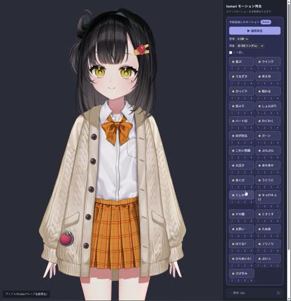

[← Back to gallery](../browse/characters.en.md) · [简体中文](2103384608301830297.md)

# A Live2D Character Yawns and Sneezes

**[ろてじん · @rotejin](https://x.com/rotejin)** · Pixel art & characters · 27s

> Discovery pool · Source verified; catalog details being completed.

**[▶ Open gallery to play](https://guanmo-ai.github.io/awesome-ai-motion/?lang=en#case-2103384608301830297)** · [Original post](https://x.com/rotejin/status/2103384608301830297)

Click the cover to open the gallery and play.

[Live2D motion-generation and preview tool](https://github.com/shinshin86/live2d-add-motion-sample-web-ui)

A cartoon character performs yawns, sneezes and other motions through model parameters and added animation.

## Source & web pages

- **Related tool**：[Live2D motion-generation and preview tool](https://github.com/shinshin86/live2d-add-motion-sample-web-ui) · [MIT](https://github.com/shinshin86/live2d-add-motion-sample-web-ui/blob/main/LICENSE)
  A general motion tool by shinshin86, slightly modified by the creator. Character models are not bundled and retain their own license terms.
  [Link source](https://x.com/rotejin/status/2103384608301830297) · Link checked 2026-11-02 15:38 UTC

No public prompt has been verified. [View the original post](https://x.com/rotejin/status/2103384608301830297)

Bookmarks — · Likes — · Views —

## Source record

- Original post: [@rotejin](https://x.com/rotejin/status/2103384608301830297) · 2026-09-25T07:22:24+00:00
- Model attribution: Claude Opus 5.5 · [Creator’s statement](https://x.com/rotejin/status/2103384608301830297)
- Prompt lookup: [Creator post](https://x.com/rotejin/status/2103384608301830297) · 2026-11-02 15:38 UTC
- Cover source: [Original cover source](https://x.com/rotejin/status/2103384608301830297) · 5.44s
- Metrics snapshot: [Original X post](https://x.com/rotejin/status/2103384608301830297) · 2026-11-02 15:05 UTC
- Gallery video source: [Original post media record](https://x.com/rotejin/status/2103384608301830297) · 2026-11-02 15:38 UTC · Post/media correspondence and media response checked; external reference, no re-upload

Model attribution is based on creator statements. Prompts have not been independently rerun; sound and visuals have not received a uniform quality rating. Videos reference original post media, not our uploads; redistribution permission has not been verified.
