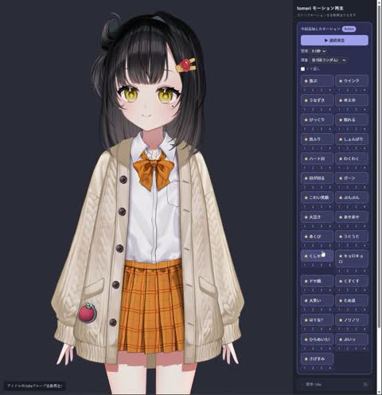

[← 返回图库](../browse/characters.md) · [English](2103384608301830297.en.md)

# Live2D 角色的哈欠与喷嚏动作

**[ろてじん · @rotejin](https://x.com/rotejin)** · 角色动画 · 27s

> 发现池 · 来源已核对，编目资料待完善。

**[▶ 打开画廊播放](https://guanmo-ai.github.io/awesome-ai-motion/#case-2103384608301830297)** · [作者原帖](https://x.com/rotejin/status/2103384608301830297)

点击封面打开画廊播放。

[Live2D 动作生成与预览工具](https://github.com/shinshin86/live2d-add-motion-sample-web-ui)

卡通角色通过模型参数和新增动作呈现哈欠、喷嚏等表演。

## 源码与网页

- **相关工具**：[Live2D 动作生成与预览工具](https://github.com/shinshin86/live2d-add-motion-sample-web-ui) · [MIT](https://github.com/shinshin86/live2d-add-motion-sample-web-ui/blob/main/LICENSE)
  shinshin86公开的通用动作工具，作者说明略有改动；角色模型不包含在仓库中，须遵守其单独许可。
  [链接出处](https://x.com/rotejin/status/2103384608301830297) · 链接核对 2026-11-02 15:38 UTC

未取得作者公开提示词。 [查看作者原帖](https://x.com/rotejin/status/2103384608301830297)

收藏 — · 点赞 — · 浏览 —

## 来源记录

- 作品原帖: [@rotejin](https://x.com/rotejin/status/2103384608301830297) · 2026-09-25T07:22:24+00:00
- 模型归因: Claude Opus 5.5 · [作者说明](https://x.com/rotejin/status/2103384608301830297)
- 提示词查阅记录: [作者原帖](https://x.com/rotejin/status/2103384608301830297) · 2026-11-02 15:38 UTC
- 封面来源: [原帖封面来源](https://x.com/rotejin/status/2103384608301830297) · 5.44s
- 互动快照: [X 原帖](https://x.com/rotejin/status/2103384608301830297) · 2026-11-02 15:05 UTC
- 画廊原视频: [原帖媒体记录](https://x.com/rotejin/status/2103384608301830297) · 2026-11-02 15:38 UTC · 已核对原帖媒体对应与媒体响应；外部引用，不重新上传

模型依据来自作者自述，未独立重跑提示词，也未对音画作统一质量评级。视频引用作者原帖媒体，未由本站重新上传，转载许可未确认。
