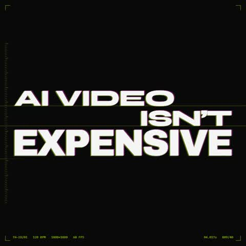

[← Back to gallery](../browse/motion.en.md) · [简体中文](2103411244468498547.md)

# A High-Contrast Type-and-Shape Motion Piece

**[TechHalla · @techhalla](https://x.com/techhalla)** · Motion design · 20s

> Discovery pool · Source verified; catalog details being completed.

**[▶ Open gallery to play](https://guanmo-ai.github.io/awesome-ai-motion/?lang=en#case-2103411244468498547)** · [Original post](https://x.com/techhalla/status/2103411244468498547)

Click the cover to open the gallery and play.

Bold titles, cuts and geometry form a twenty-second piece the creator says is entirely coded.

No public prompt has been verified. [View the original post](https://x.com/techhalla/status/2103411244468498547)

Bookmarks — · Likes — · Views —

## Source record

- Original post: [@techhalla](https://x.com/techhalla/status/2103411244468498547) · 2026-09-25T09:08:14+00:00
- Model attribution: Claude Opus 5.5 · [Creator’s statement](https://x.com/techhalla/status/2103411244468498547)
- Prompt lookup: [Creator post](https://x.com/techhalla/status/2103411244468498547) · 2026-11-02 09:52 UTC
- Cover source: [Original cover source](https://x.com/techhalla/status/2103411244468498547) · 4.01s
- Metrics snapshot: [Original X post](https://x.com/techhalla/status/2103411244468498547) · 2026-11-02 09:13 UTC
- Gallery video source: [Original post media record](https://x.com/techhalla/status/2103411244468498547) · 2026-11-02 09:52 UTC · Post/media correspondence and media response checked; external reference, no re-upload

Model attribution is based on creator statements. Prompts have not been independently rerun; sound and visuals have not received a uniform quality rating. Videos reference original post media, not our uploads; redistribution permission has not been verified.
