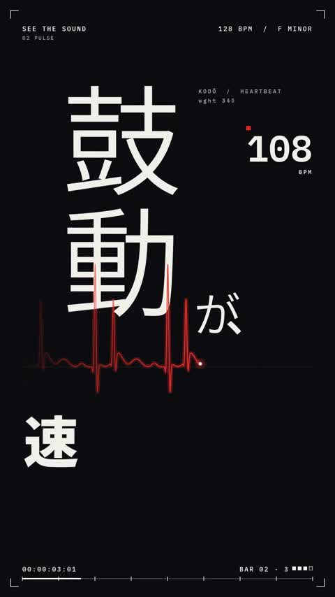

[← Back to gallery](../browse/music.en.md) · [简体中文](2103416250743574988.md)

# Japanese Kinetic Type in a Vertical MV

**[IT navi · @itnavi2022](https://x.com/itnavi2022)** · Music & lyrics · 15s

> Discovery pool · Source verified; catalog details being completed.

**[▶ Open gallery to play](https://guanmo-ai.github.io/awesome-ai-motion/?lang=en#case-2103416250743574988)** · [Original post](https://x.com/itnavi2022/status/2103416250743574988)

Click the cover to open the gallery and play.

Japanese glyphs, numbers and layouts change with the music across dark and light backgrounds.

The creator has shared instructions; this catalog links to the source without redistributing the full text or translation. [Read the creator’s original](https://x.com/itnavi2022/status/2103416250743574988)

Bookmarks — · Likes — · Views —

## Source record

- Original post: [@itnavi2022](https://x.com/itnavi2022/status/2103416250743574988) · 2026-09-25T09:28:08+00:00
- Model attribution: Claude Opus 5.5 · [Creator’s statement](https://x.com/itnavi2022/status/2103416250743574988)
- Prompt source: [Creator post](https://x.com/itnavi2022/status/2103416250743574988) · 2026-11-02 09:52 UTC
- Cover source: [Original cover source](https://x.com/itnavi2022/status/2103416250743574988) · 3.01s
- Metrics snapshot: [Original X post](https://x.com/itnavi2022/status/2103416250743574988) · 2026-11-02 09:13 UTC
- Gallery video source: [Original post media record](https://x.com/itnavi2022/status/2103416250743574988) · 2026-11-02 09:52 UTC · Post/media correspondence and media response checked; external reference, no re-upload

Model attribution is based on creator statements. Prompts have not been independently rerun; sound and visuals have not received a uniform quality rating. Videos reference original post media, not our uploads; redistribution permission has not been verified.
