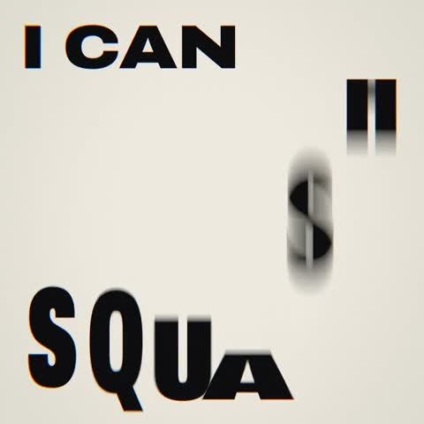

[← Back to gallery](../browse/motion.en.md) · [简体中文](2103418664854622583.md)

# A Motion Study in Split and Offset Letterforms

**[Eugene C · @zheke](https://x.com/zheke)** · Motion design · 15s

> Discovery pool · Source verified; catalog details being completed.

**[▶ Open gallery to play](https://guanmo-ai.github.io/awesome-ai-motion/?lang=en#case-2103418664854622583)** · [Original post](https://x.com/zheke/status/2103418664854622583)

Click the cover to open the gallery and play.

Large letterforms split, stretch and reassemble with offsets against simple backgrounds.

The creator has shared instructions; this catalog links to the source without redistributing the full text or translation. [Read the creator’s original](https://x.com/zheke/status/2103418664854622583)

Bookmarks — · Likes — · Views —

## Source record

- Original post: [@zheke](https://x.com/zheke/status/2103418664854622583) · 2026-09-25T09:37:43+00:00
- Model attribution: Claude Opus 5.5 · [Creator’s statement](https://x.com/zheke/status/2103418664854622583)
- Prompt source: [Creator post](https://x.com/zheke/status/2103418664854622583) · 2026-11-02 09:52 UTC
- Cover source: [Original cover source](https://x.com/zheke/status/2103418664854622583) · 3.01s
- Metrics snapshot: [Original X post](https://x.com/zheke/status/2103418664854622583) · 2026-11-02 09:13 UTC
- Gallery video source: [Original post media record](https://x.com/zheke/status/2103418664854622583) · 2026-11-02 09:52 UTC · Post/media correspondence and media response checked; external reference, no re-upload

Model attribution is based on creator statements. Prompts have not been independently rerun; sound and visuals have not received a uniform quality rating. Videos reference original post media, not our uploads; redistribution permission has not been verified.
