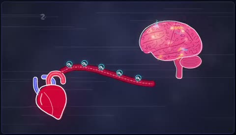

[← Back to gallery](../browse/education.en.md) · [简体中文](2103442781096288376.md)

# Hand-Drawn Organ Graphics about Brain Death

**[頓花聖太郎｜YAMI · @tonka1981jp](https://x.com/tonka1981jp)** · Education & explainers · 60s

> Discovery pool · Source verified; catalog details being completed.

**[▶ Open gallery to play](https://guanmo-ai.github.io/awesome-ai-motion/?lang=en#case-2103442781096288376)** · [Original post](https://x.com/tonka1981jp/status/2103442781096288376)

Click the cover to open the gallery and play.

Brain, heart and checklist graphics change through an explainer whose medical content is not independently verified.

The creator has shared instructions; this catalog links to the source without redistributing the full text or translation. [Read the creator’s original](https://x.com/tonka1981jp/status/2103442781096288376)

Bookmarks — · Likes — · Views —

## Source record

- Original post: [@tonka1981jp](https://x.com/tonka1981jp/status/2103442781096288376) · 2026-09-25T11:13:33+00:00
- Model attribution: Claude Opus 5.5 · [Creator’s statement](https://x.com/tonka1981jp/status/2103442781096288376)
- Prompt source: [Creator post](https://x.com/tonka1981jp/status/2103442781096288376) · 2026-11-02 15:38 UTC
- Cover source: [Original cover source](https://x.com/tonka1981jp/status/2103442781096288376) · 12.05s
- Metrics snapshot: [Original X post](https://x.com/tonka1981jp/status/2103442781096288376) · 2026-11-02 15:08 UTC
- Gallery video source: [Original post media record](https://x.com/tonka1981jp/status/2103442781096288376) · 2026-11-02 15:38 UTC · Post/media correspondence and media response checked; external reference, no re-upload

Model attribution is based on creator statements. Prompts have not been independently rerun; sound and visuals have not received a uniform quality rating. Videos reference original post media, not our uploads; redistribution permission has not been verified.
