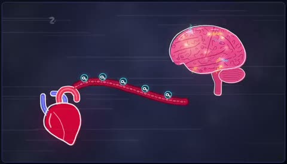

[← 返回图库](../browse/education.md) · [English](2103442781096288376.en.md)

# 脑死亡主题的手绘器官图解

**[頓花聖太郎｜YAMI · @tonka1981jp](https://x.com/tonka1981jp)** · 知识讲解 · 60s

> 发现池 · 来源已核对，编目资料待完善。

**[▶ 打开画廊播放](https://guanmo-ai.github.io/awesome-ai-motion/#case-2103442781096288376)** · [作者原帖](https://x.com/tonka1981jp/status/2103442781096288376)

点击封面打开画廊播放。

脑、心脏与检查卡片随讲解变化；本条记录动画表达，未独立核验医学内容。

作者已公开指令；本站仅提供原帖入口，不再分发全文或译文。 [查看作者原文](https://x.com/tonka1981jp/status/2103442781096288376)

收藏 — · 点赞 — · 浏览 —

## 来源记录

- 作品原帖: [@tonka1981jp](https://x.com/tonka1981jp/status/2103442781096288376) · 2026-09-25T11:13:33+00:00
- 模型归因: Claude Opus 5.5 · [作者说明](https://x.com/tonka1981jp/status/2103442781096288376)
- 提示词出处: [作者原帖](https://x.com/tonka1981jp/status/2103442781096288376) · 2026-11-02 15:38 UTC
- 封面来源: [原帖封面来源](https://x.com/tonka1981jp/status/2103442781096288376) · 12.05s
- 互动快照: [X 原帖](https://x.com/tonka1981jp/status/2103442781096288376) · 2026-11-02 15:08 UTC
- 画廊原视频: [原帖媒体记录](https://x.com/tonka1981jp/status/2103442781096288376) · 2026-11-02 15:38 UTC · 已核对原帖媒体对应与媒体响应；外部引用，不重新上传

模型依据来自作者自述，未独立重跑提示词，也未对音画作统一质量评级。视频引用作者原帖媒体，未由本站重新上传，转载许可未确认。
