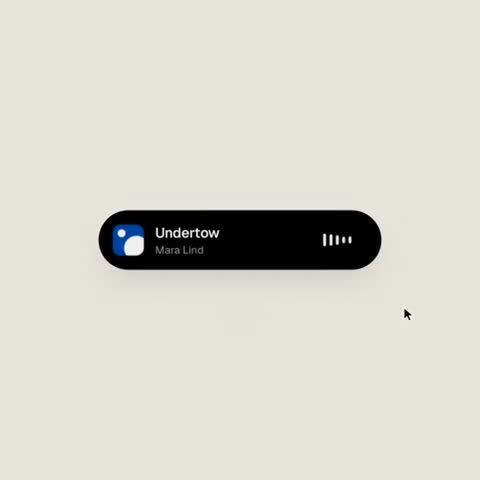

[← Back to gallery](../browse/motion.en.md) · [简体中文](2103456358125457691.md)

# One Control Morphs between a Player and Tabs

**[Sanjeev Nair · @sanjeevn72](https://x.com/sanjeevn72)** · Motion design · 14s

> Discovery pool · Source verified; catalog details being completed.

**[▶ Open gallery to play](https://guanmo-ai.github.io/awesome-ai-motion/?lang=en#case-2103456358125457691)** · [Original post](https://x.com/sanjeevn72/status/2103456358125457691)

Click the cover to open the gallery and play.

A rounded monochrome control morphs between a music player, progress bar and tabs, guided by cursor actions and spring-like movement.

The creator has shared instructions; this catalog links to the source without redistributing the full text or translation. [Read the creator’s original](https://x.com/sanjeevn72/status/2103456484793151834)

Bookmarks 5 · Likes 3 · Views 858

## Source record

- Original post: [@sanjeevn72](https://x.com/sanjeevn72/status/2103456358125457691) · 2026-09-25T12:07:30+00:00
- Model attribution: Claude Opus 5.5 · [Creator’s statement](https://x.com/sanjeevn72/status/2103456358125457691)
- Prompt source: [Creator post](https://x.com/sanjeevn72/status/2103456484793151834) · 2026-10-23 05:30 UTC
- Cover source: [Original cover source](https://x.com/sanjeevn72/status/2103456358125457691) · 2.8s
- Metrics snapshot: [Original X post](https://x.com/sanjeevn72/status/2103456358125457691) · 2026-10-23 05:30 UTC
- Gallery video source: [Original post media record](https://x.com/sanjeevn72/status/2103456358125457691) · 2026-10-23 05:30 UTC · Post/media correspondence and media response checked; external reference, no re-upload

Model attribution is based on creator statements. Prompts have not been independently rerun; sound and visuals have not received a uniform quality rating. Videos reference original post media, not our uploads; redistribution permission has not been verified.
