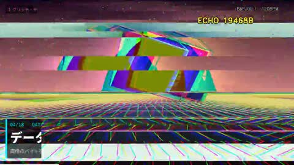

[← 返回图库](../browse/motion.md) · [English](2103476071018766790.en.md)

# 视觉特效与转场技法集

**[クチナワ🎮ゲームについて書く人 · @Kutinawa\_VGamer](https://x.com/Kutinawa_VGamer)** · 短动效 · 80s

> 发现池 · 来源已核对，编目资料待完善。

**[▶ 打开画廊播放](https://guanmo-ai.github.io/awesome-ai-motion/#case-2103476071018766790)** · [作者原帖](https://x.com/Kutinawa_VGamer/status/2103476071018766790)

点击封面打开画廊播放。

以故障切片、色彩叠加和图形变换展示多种视觉技法。

未取得作者公开提示词。 [查看作者原帖](https://x.com/Kutinawa_VGamer/status/2103476071018766790)

收藏 — · 点赞 — · 浏览 —

## 来源记录

- 作品原帖: [@Kutinawa\_VGamer](https://x.com/Kutinawa_VGamer/status/2103476071018766790) · 2026-09-25T13:25:50+00:00
- 模型归因: Claude Opus 5.5 · [作者说明](https://x.com/Kutinawa_VGamer/status/2103476071018766790)
- 提示词查阅记录: [作者原帖](https://x.com/Kutinawa_VGamer/status/2103476071018766790) · 2026-11-03 09:18 UTC
- 封面来源: [原帖封面来源](https://x.com/Kutinawa_VGamer/status/2103476071018766790) · 16.01s
- 互动快照: [X 原帖](https://x.com/Kutinawa_VGamer/status/2103476071018766790) · 2026-11-03 08:42 UTC
- 画廊原视频: [原帖媒体记录](https://x.com/Kutinawa_VGamer/status/2103476071018766790) · 2026-11-03 09:18 UTC · 已核对原帖媒体对应与媒体响应；外部引用，不重新上传

模型依据来自作者自述，未独立重跑提示词，也未对音画作统一质量评级。视频引用作者原帖媒体，未由本站重新上传，转载许可未确认。
