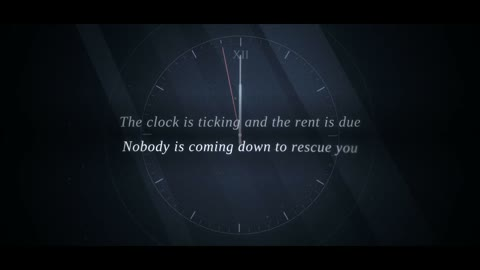

[← Back to gallery](../browse/music.en.md) · [简体中文](2103479649728921896.md)

# A Lyric Reel from Quiet to the Drop

**[Kisalay · @Kisalay\_](https://x.com/Kisalay_)** · Music & lyrics · 15s

> Discovery pool · Source verified; catalog details being completed.

**[▶ Open gallery to play](https://guanmo-ai.github.io/awesome-ai-motion/?lang=en#case-2103479649728921896)** · [Original post](https://x.com/Kisalay_/status/2103479649728921896)

Click the cover to open the gallery and play.

Dark lyric layouts shift to bright geometry and neon lines, contrasting the song's sections.

No public prompt has been verified. [View the original post](https://x.com/Kisalay_/status/2103479649728921896)

Bookmarks — · Likes — · Views —

## Source record

- Original post: [@Kisalay\_](https://x.com/Kisalay_/status/2103479649728921896) · 2026-09-25T13:40:03+00:00
- Model attribution: Claude Opus 5.5 · [Creator’s statement](https://x.com/Kisalay_/status/2103479649728921896)
- Prompt lookup: [Creator post](https://x.com/Kisalay_/status/2103479649728921896) · 2026-11-02 09:52 UTC
- Cover source: [Original cover source](https://x.com/Kisalay_/status/2103479649728921896) · 3.01s
- Metrics snapshot: [Original X post](https://x.com/Kisalay_/status/2103479649728921896) · 2026-11-02 09:13 UTC
- Gallery video source: [Original post media record](https://x.com/Kisalay_/status/2103479649728921896) · 2026-11-02 09:52 UTC · Post/media correspondence and media response checked; external reference, no re-upload

Model attribution is based on creator statements. Prompts have not been independently rerun; sound and visuals have not received a uniform quality rating. Videos reference original post media, not our uploads; redistribution permission has not been verified.
