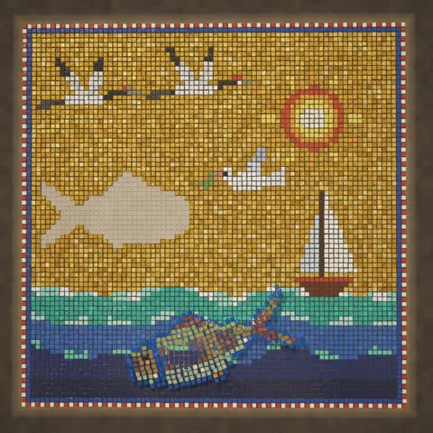

[← Back to gallery](../browse/motion.en.md) · [简体中文](2103481227005341943.md)

# An Eighty-Second Mosaic Film of Flying Tiles

**[Nischal · @nischalsharma\_](https://x.com/nischalsharma_)** · Motion design · 80s

> Discovery pool · Source verified; catalog details being completed.

**[▶ Open gallery to play](https://guanmo-ai.github.io/awesome-ai-motion/?lang=en#case-2103481227005341943)** · [Original post](https://x.com/nischalsharma_/status/2103481227005341943)

Click the cover to open the gallery and play.

Tiles scatter and reform among fish, sea, daylight and starry night, with visuals and sound generated in one HTML file.

The creator has shared instructions; this catalog links to the source without redistributing the full text or translation. [Read the creator’s original](https://x.com/nischalsharma_/status/2103484041718587738)

Bookmarks — · Likes — · Views —

## Source record

- Original post: [@nischalsharma\_](https://x.com/nischalsharma_/status/2103481227005341943) · 2026-09-25T13:46:19+00:00
- Model attribution: Claude Opus 5.5 · [Creator’s statement](https://x.com/nischalsharma_/status/2103481227005341943)
- Prompt source: [Creator post](https://x.com/nischalsharma_/status/2103484041718587738) · 2026-11-02 09:52 UTC
- Cover source: [Original cover source](https://x.com/nischalsharma_/status/2103481227005341943) · 16.01s
- Metrics snapshot: [Original X post](https://x.com/nischalsharma_/status/2103481227005341943) · 2026-11-02 09:36 UTC
- Gallery video source: [Original post media record](https://x.com/nischalsharma_/status/2103481227005341943) · 2026-11-02 09:52 UTC · Post/media correspondence and media response checked; external reference, no re-upload

Model attribution is based on creator statements. Prompts have not been independently rerun; sound and visuals have not received a uniform quality rating. Videos reference original post media, not our uploads; redistribution permission has not been verified.
