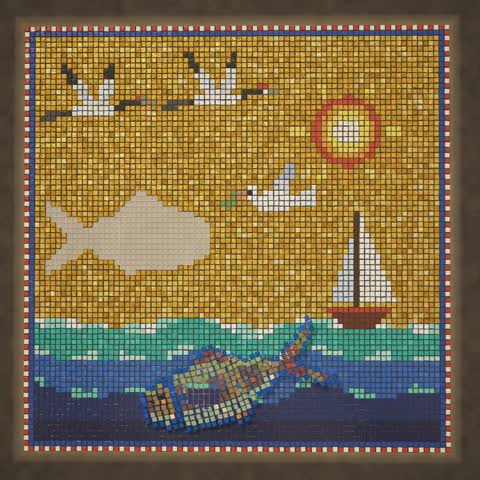

[← 返回图库](../browse/motion.md) · [English](2103481227005341943.en.md)

# 飞散瓷砖组成的八十秒马赛克电影

**[Nischal · @nischalsharma\_](https://x.com/nischalsharma_)** · 短动效 · 80s

> 发现池 · 来源已核对，编目资料待完善。

**[▶ 打开画廊播放](https://guanmo-ai.github.io/awesome-ai-motion/#case-2103481227005341943)** · [作者原帖](https://x.com/nischalsharma_/status/2103481227005341943)

点击封面打开画廊播放。

瓷砖在鱼、海面、白昼与星夜之间飞散重组，画面与声音由单个 HTML 文件生成。

作者已公开指令；本站仅提供原帖入口，不再分发全文或译文。 [查看作者原文](https://x.com/nischalsharma_/status/2103484041718587738)

收藏 — · 点赞 — · 浏览 —

## 来源记录

- 作品原帖: [@nischalsharma\_](https://x.com/nischalsharma_/status/2103481227005341943) · 2026-09-25T13:46:19+00:00
- 模型归因: Claude Opus 5.5 · [作者说明](https://x.com/nischalsharma_/status/2103481227005341943)
- 提示词出处: [作者原帖](https://x.com/nischalsharma_/status/2103484041718587738) · 2026-11-02 09:52 UTC
- 封面来源: [原帖封面来源](https://x.com/nischalsharma_/status/2103481227005341943) · 16.01s
- 互动快照: [X 原帖](https://x.com/nischalsharma_/status/2103481227005341943) · 2026-11-02 09:36 UTC
- 画廊原视频: [原帖媒体记录](https://x.com/nischalsharma_/status/2103481227005341943) · 2026-11-02 09:52 UTC · 已核对原帖媒体对应与媒体响应；外部引用，不重新上传

模型依据来自作者自述，未独立重跑提示词，也未对音画作统一质量评级。视频引用作者原帖媒体，未由本站重新上传，转载许可未确认。
