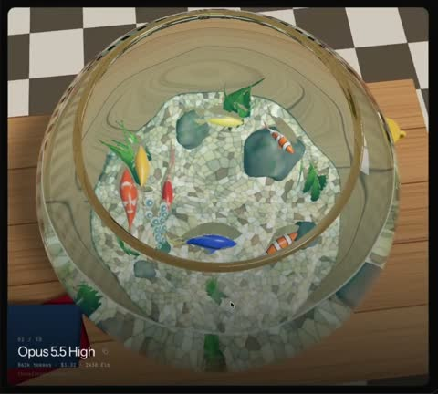

[← Back to gallery](../browse/motion.en.md) · [简体中文](2103499771206156628.md)

# Fishbowl Refraction and Caustics

**[Nicola · @NicolaManzini](https://x.com/NicolaManzini)** · Motion design · 35s

> Discovery pool · Source verified; catalog details being completed.

**[▶ Open gallery to play](https://guanmo-ai.github.io/awesome-ai-motion/?lang=en#case-2103499771206156628)** · [Original post](https://x.com/NicolaManzini/status/2103499771206156628)

Click the cover to open the gallery and play.

Fish, water and glass refraction create moving light in a coded fishbowl.

No public prompt has been verified. [View the original post](https://x.com/NicolaManzini/status/2103499771206156628)

Bookmarks — · Likes — · Views —

## Source record

- Original post: [@NicolaManzini](https://x.com/NicolaManzini/status/2103499771206156628) · 2026-09-25T15:00:01+00:00
- Model attribution: Claude Opus 5.5 · [Creator’s statement](https://x.com/NicolaManzini/status/2103499771206156628)
- Prompt lookup: [Creator post](https://x.com/NicolaManzini/status/2103499771206156628) · 2026-11-03 09:18 UTC
- Cover source: [Original cover source](https://x.com/NicolaManzini/status/2103499771206156628) · 6.94s
- Metrics snapshot: [Original X post](https://x.com/NicolaManzini/status/2103499771206156628) · 2026-11-03 08:42 UTC
- Gallery video source: [Original post media record](https://x.com/NicolaManzini/status/2103499771206156628) · 2026-11-03 09:18 UTC · Post/media correspondence and media response checked; external reference, no re-upload

Model attribution is based on creator statements. Prompts have not been independently rerun; sound and visuals have not received a uniform quality rating. Videos reference original post media, not our uploads; redistribution permission has not been verified.
