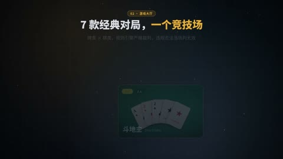

[← Back to gallery](../browse/product.en.md) · [简体中文](2103501705698750731.md)

# AI Arena Promoted with Cards and Interface Motion

**[大帅老猿 · @ezshine](https://x.com/ezshine)** · Product & marketing · 66s

> Discovery pool · Source verified; catalog details being completed.

**[▶ Open gallery to play](https://guanmo-ai.github.io/awesome-ai-motion/?lang=en#case-2103501705698750731)** · [Original post](https://x.com/ezshine/status/2103501705698750731)

Click the cover to open the gallery and play.

Cards, panels and large explanatory type change in sections to introduce a product.

No public prompt has been verified. [View the original post](https://x.com/ezshine/status/2103501705698750731)

Bookmarks — · Likes — · Views —

## Source record

- Original post: [@ezshine](https://x.com/ezshine/status/2103501705698750731) · 2026-09-25T15:07:42+00:00
- Model attribution: Claude Opus 5.5 · [Creator’s statement](https://x.com/ezshine/status/2103501705698750731)
- Prompt lookup: [Creator post](https://x.com/ezshine/status/2103501705698750731) · 2026-11-02 09:52 UTC
- Cover source: [Original cover source](https://x.com/ezshine/status/2103501705698750731) · 13.11s
- Metrics snapshot: [Original X post](https://x.com/ezshine/status/2103501705698750731) · 2026-11-02 09:13 UTC
- Gallery video source: [Original post media record](https://x.com/ezshine/status/2103501705698750731) · 2026-11-02 09:52 UTC · Post/media correspondence and media response checked; external reference, no re-upload

Model attribution is based on creator statements. Prompts have not been independently rerun; sound and visuals have not received a uniform quality rating. Videos reference original post media, not our uploads; redistribution permission has not been verified.
