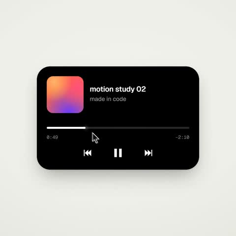

[← Back to gallery](../browse/motion.en.md) · [简体中文](2103502194578174321.md)

# Interface Motion Driven by Time Functions

**[yankis · @yankis0x](https://x.com/yankis0x)** · Motion design · 14s

> Discovery pool · Source verified; catalog details being completed.

**[▶ Open gallery to play](https://guanmo-ai.github.io/awesome-ai-motion/?lang=en#case-2103502194578174321)** · [Original post](https://x.com/yankis0x/status/2103502194578174321)

Click the cover to open the gallery and play.

Buttons, a player and cards transform within one interface shape in a time-driven motion study.

No public prompt has been verified. [View the original post](https://x.com/yankis0x/status/2103502194578174321)

Bookmarks — · Likes — · Views —

## Source record

- Original post: [@yankis0x](https://x.com/yankis0x/status/2103502194578174321) · 2026-09-25T15:09:39+00:00
- Model attribution: Claude Opus 5.5 · [Creator’s statement](https://x.com/yankis0x/status/2103502194578174321)
- Prompt lookup: [Creator post](https://x.com/yankis0x/status/2103502194578174321) · 2026-11-02 15:38 UTC
- Cover source: [Original cover source](https://x.com/yankis0x/status/2103502194578174321) · 2.82s
- Metrics snapshot: [Original X post](https://x.com/yankis0x/status/2103502194578174321) · 2026-11-02 15:08 UTC
- Gallery video source: [Original post media record](https://x.com/yankis0x/status/2103502194578174321) · 2026-11-02 15:38 UTC · Post/media correspondence and media response checked; external reference, no re-upload

Model attribution is based on creator statements. Prompts have not been independently rerun; sound and visuals have not received a uniform quality rating. Videos reference original post media, not our uploads; redistribution permission has not been verified.
