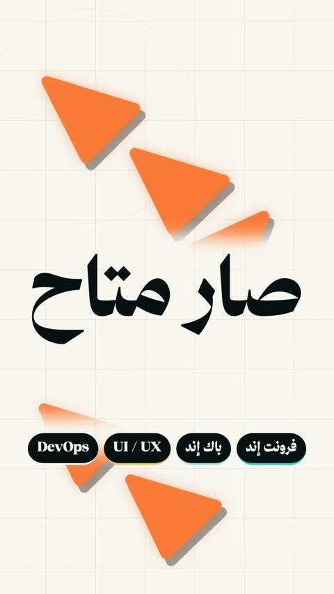

[← Back to gallery](../browse/motion.en.md) · [简体中文](2103505435802341449.md)

# Arabic Type and Geometric Motion

**[Yarob \| يعرُب 💻 · @YarHmm](https://x.com/YarHmm)** · Motion design · 56s

> Discovery pool · Source verified; catalog details being completed.

**[▶ Open gallery to play](https://guanmo-ai.github.io/awesome-ai-motion/?lang=en#case-2103505435802341449)** · [Original post](https://x.com/YarHmm/status/2103505435802341449)

Click the cover to open the gallery and play.

Arabic type, triangles and rhythmic icons alternate in a vertical motion piece.

No public prompt has been verified. [View the original post](https://x.com/YarHmm/status/2103505435802341449)

Bookmarks — · Likes — · Views —

## Source record

- Original post: [@YarHmm](https://x.com/YarHmm/status/2103505435802341449) · 2026-09-25T15:22:31+00:00
- Model attribution: Claude Opus 5.5 · [Creator’s statement](https://x.com/YarHmm/status/2103505435802341449)
- Prompt lookup: [Creator post](https://x.com/YarHmm/status/2103505435802341449) · 2026-11-02 09:52 UTC
- Cover source: [Original cover source](https://x.com/YarHmm/status/2103505435802341449) · 11.14s
- Metrics snapshot: [Original X post](https://x.com/YarHmm/status/2103505435802341449) · 2026-11-02 09:13 UTC
- Gallery video source: [Original post media record](https://x.com/YarHmm/status/2103505435802341449) · 2026-11-02 09:52 UTC · Post/media correspondence and media response checked; external reference, no re-upload

Model attribution is based on creator statements. Prompts have not been independently rerun; sound and visuals have not received a uniform quality rating. Videos reference original post media, not our uploads; redistribution permission has not been verified.
