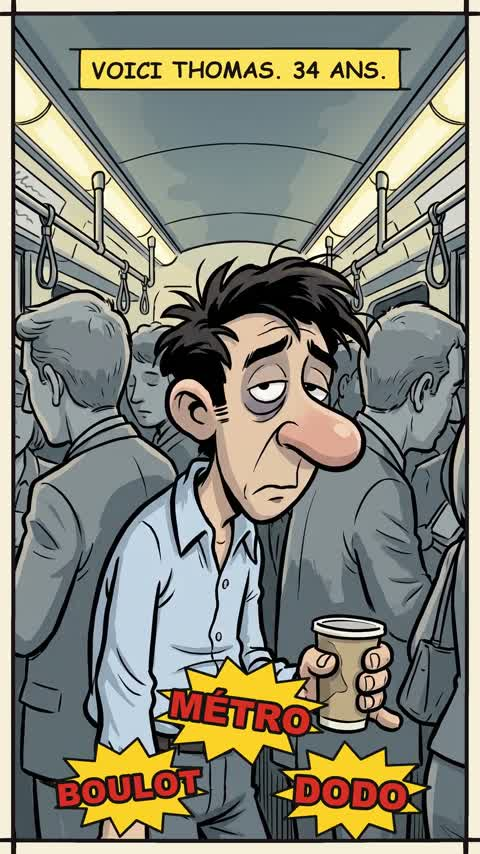

[← Back to gallery](../browse/stories.en.md) · [简体中文](2103514734716977599.md)

# A Franco-Belgian Comic Coffee Ad

**[JA \| Ազատ · @jeanalexandre\_b](https://x.com/jeanalexandre_b)** · Narrative films · 85s

> Discovery pool · Source verified; catalog details being completed.

**[▶ Open gallery to play](https://guanmo-ai.github.io/awesome-ai-motion/?lang=en#case-2103514734716977599)** · [Original post](https://x.com/jeanalexandre_b/status/2103514734716977599)

Click the cover to open the gallery and play.

Comic characters travel through the Paris metro and everyday scenes, telling a coffee ad through dialogue and character motion.

No public prompt has been verified. [View the original post](https://x.com/jeanalexandre_b/status/2103514734716977599)

Bookmarks — · Likes — · Views —

## Source record

- Original post: [@jeanalexandre\_b](https://x.com/jeanalexandre_b/status/2103514734716977599) · 2026-09-25T15:59:28+00:00
- Model attribution: Claude Opus 5.5 · [Creator’s statement](https://x.com/jeanalexandre_b/status/2103514734716977599)
- Prompt lookup: [Creator post](https://x.com/jeanalexandre_b/status/2103514734716977599) · 2026-11-02 15:38 UTC
- Cover source: [Original cover source](https://x.com/jeanalexandre_b/status/2103514734716977599) · 16.91s
- Metrics snapshot: [Original X post](https://x.com/jeanalexandre_b/status/2103514734716977599) · 2026-11-02 15:05 UTC
- Gallery video source: [Original post media record](https://x.com/jeanalexandre_b/status/2103514734716977599) · 2026-11-02 15:38 UTC · Post/media correspondence and media response checked; external reference, no re-upload

Model attribution is based on creator statements. Prompts have not been independently rerun; sound and visuals have not received a uniform quality rating. Videos reference original post media, not our uploads; redistribution permission has not been verified.
