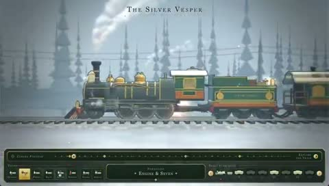

[← 返回图库](../browse/interactive.md) · [English](2103525797822960007.en.md)

# Silver Vesper 列车探索

**[Dilum Sanjaya · @DilumSanjaya](https://x.com/DilumSanjaya)** · 交互演示 · 44s

> 发现池 · 来源已核对，编目资料待完善。

**[▶ 打开画廊播放](https://guanmo-ai.github.io/awesome-ai-motion/#case-2103525797822960007)** · [作者原帖](https://x.com/DilumSanjaya/status/2103525797822960007)

点击封面打开画廊播放。

列车结构、机械细节与说明面板组成可探索的三维展示。

未取得作者公开提示词。 [查看作者原帖](https://x.com/DilumSanjaya/status/2103525797822960007)

收藏 85 · 点赞 215 · 浏览 15,786

## 来源记录

- 作品原帖: [@DilumSanjaya](https://x.com/DilumSanjaya/status/2103525797822960007) · 2026-09-25T16:43:26+00:00
- 模型归因: Opus 5.5 · [作者说明](https://x.com/DilumSanjaya/status/2103525797822960007)
- 提示词查阅记录: [作者原帖](https://x.com/DilumSanjaya/status/2103525797822960007) · 2026-10-19 09:12 UTC
- 封面来源: [原帖封面来源](https://x.com/DilumSanjaya/status/2103525797822960007) · 8.87s
- 互动快照: [X 原帖](https://x.com/DilumSanjaya/status/2103525797822960007) · 2026-10-19 09:12 UTC
- 画廊原视频: [原帖媒体记录](https://x.com/DilumSanjaya/status/2103525797822960007) · 2026-10-19 09:12 UTC · 已核对原帖媒体对应与媒体响应；外部引用，不重新上传

模型依据来自作者自述，未独立重跑提示词，也未对音画作统一质量评级。视频引用作者原帖媒体，未由本站重新上传，转载许可未确认。
