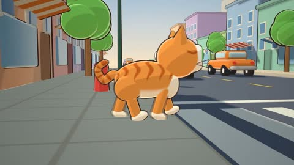

[← Back to gallery](../browse/characters.en.md) · [简体中文](2103530789510283635.md)

# Cartoon Cat Crossing a City Street

**[Serhat Demir · @wzarok](https://x.com/wzarok)** · Pixel art & characters · 24s

> Discovery pool · Source verified; catalog details being completed.

**[▶ Open gallery to play](https://guanmo-ai.github.io/awesome-ai-motion/?lang=en#case-2103530789510283635)** · [Original post](https://x.com/wzarok/status/2103530789510283635)

Click the cover to open the gallery and play.

An orange cat walks through a 3D cartoon street with vehicles and buildings.

No public prompt has been verified. [View the original post](https://x.com/wzarok/status/2103530789510283635)

Bookmarks — · Likes — · Views —

## Source record

- Original post: [@wzarok](https://x.com/wzarok/status/2103530789510283635) · 2026-09-25T17:03:16+00:00
- Model attribution: Claude Opus 5.5 · [Creator’s statement](https://x.com/wzarok/status/2103530789510283635)
- Prompt lookup: [Creator post](https://x.com/wzarok/status/2103530789510283635) · 2026-11-03 09:18 UTC
- Cover source: [Original cover source](https://x.com/wzarok/status/2103530789510283635) · 4.81s
- Metrics snapshot: [Original X post](https://x.com/wzarok/status/2103530789510283635) · 2026-11-03 08:42 UTC
- Gallery video source: [Original post media record](https://x.com/wzarok/status/2103530789510283635) · 2026-11-03 09:18 UTC · Post/media correspondence and media response checked; external reference, no re-upload

Model attribution is based on creator statements. Prompts have not been independently rerun; sound and visuals have not received a uniform quality rating. Videos reference original post media, not our uploads; redistribution permission has not been verified.
