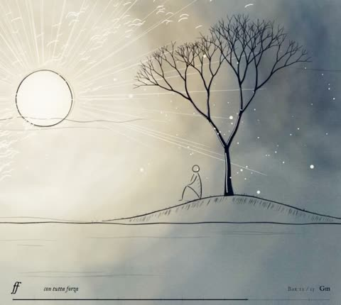

[← Back to gallery](../browse/music.en.md) · [简体中文](2103535326325055843.md)

# Violin and Seasonal Tree Animation

**[ℏεsam · @Hesamation](https://x.com/Hesamation)** · Music & lyrics · 62s

> Discovery pool · Source verified; catalog details being completed.

**[▶ Open gallery to play](https://guanmo-ai.github.io/awesome-ai-motion/?lang=en#case-2103535326325055843)** · [Original post](https://x.com/Hesamation/status/2103535326325055843)

Click the cover to open the gallery and play.

Minimal figures and a tree change with seasonal light, alongside a generated violin score.

No public prompt has been verified. [View the original post](https://x.com/Hesamation/status/2103535326325055843)

Bookmarks — · Likes — · Views —

## Source record

- Original post: [@Hesamation](https://x.com/Hesamation/status/2103535326325055843) · 2026-09-25T17:21:18+00:00
- Model attribution: Claude Opus 5.5 · [Creator’s statement](https://x.com/Hesamation/status/2103535326325055843)
- Prompt lookup: [Creator post](https://x.com/Hesamation/status/2103535326325055843) · 2026-11-03 09:18 UTC
- Cover source: [Original cover source](https://x.com/Hesamation/status/2103535326325055843) · 43.63s
- Metrics snapshot: [Original X post](https://x.com/Hesamation/status/2103535326325055843) · 2026-11-03 08:42 UTC
- Gallery video source: [Original post media record](https://x.com/Hesamation/status/2103535326325055843) · 2026-11-03 09:18 UTC · Post/media correspondence and media response checked; external reference, no re-upload

Model attribution is based on creator statements. Prompts have not been independently rerun; sound and visuals have not received a uniform quality rating. Videos reference original post media, not our uploads; redistribution permission has not been verified.
