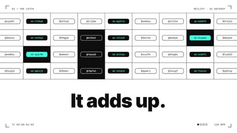

[← Back to gallery](../browse/product.en.md) · [简体中文](2103540805575278645.md)

# Netlify AI Gateway Nodes and Type

**[KP · @thisiskp\_](https://x.com/thisiskp_)** · Product & marketing · 30s

> Discovery pool · Source verified; catalog details being completed.

**[▶ Open gallery to play](https://guanmo-ai.github.io/awesome-ai-motion/?lang=en#case-2103540805575278645)** · [Original post](https://x.com/thisiskp_/status/2103540805575278645)

Click the cover to open the gallery and play.

Model nodes, quantity graphics and bold type transitions form a gateway promo.

No public prompt has been verified. [View the original post](https://x.com/thisiskp_/status/2103540805575278645)

Bookmarks — · Likes — · Views —

## Source record

- Original post: [@thisiskp\_](https://x.com/thisiskp_/status/2103540805575278645) · 2026-09-25T17:43:04+00:00
- Model attribution: Claude Opus 5.5 · [Creator’s statement](https://x.com/thisiskp_/status/2103540805575278645)
- Prompt lookup: [Creator post](https://x.com/thisiskp_/status/2103540805575278645) · 2026-11-02 15:38 UTC
- Cover source: [Original cover source](https://x.com/thisiskp_/status/2103540805575278645) · 6.01s
- Metrics snapshot: [Original X post](https://x.com/thisiskp_/status/2103540805575278645) · 2026-11-02 15:08 UTC
- Gallery video source: [Original post media record](https://x.com/thisiskp_/status/2103540805575278645) · 2026-11-02 15:38 UTC · Post/media correspondence and media response checked; external reference, no re-upload

Model attribution is based on creator statements. Prompts have not been independently rerun; sound and visuals have not received a uniform quality rating. Videos reference original post media, not our uploads; redistribution permission has not been verified.
