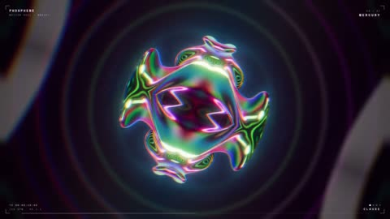

[← Back to gallery](../browse/motion.en.md) · [简体中文](2103563538828832979.md)

# Psychedelic Motion in Iridescent Forms and Rings

**[monokern · @monokern](https://x.com/monokern)** · Motion design · 20s

> Discovery pool · Source verified; catalog details being completed.

**[▶ Open gallery to play](https://guanmo-ai.github.io/awesome-ai-motion/?lang=en#case-2103563538828832979)** · [Original post](https://x.com/monokern/status/2103563538828832979)

Click the cover to open the gallery and play.

An iridescent form morphs amid concentric rings and a dark space, combining sound design with psychedelic graphics.

The creator has shared instructions; this catalog links to the source without redistributing the full text or translation. [Read the creator’s original](https://x.com/monokern/status/2103563538828832979)

Bookmarks — · Likes — · Views —

## Source record

- Original post: [@monokern](https://x.com/monokern/status/2103563538828832979) · 2026-09-25T19:13:24+00:00
- Model attribution: Claude Opus 5.5 · [Creator’s statement](https://x.com/monokern/status/2103563538828832979)
- Prompt source: [Creator post](https://x.com/monokern/status/2103563538828832979) · 2026-11-02 09:52 UTC
- Cover source: [Original cover source](https://x.com/monokern/status/2103563538828832979) · 10.03s
- Metrics snapshot: [Original X post](https://x.com/monokern/status/2103563538828832979) · 2026-11-02 09:13 UTC
- Gallery video source: [Original post media record](https://x.com/monokern/status/2103563538828832979) · 2026-11-02 09:52 UTC · Post/media correspondence and media response checked; external reference, no re-upload

Model attribution is based on creator statements. Prompts have not been independently rerun; sound and visuals have not received a uniform quality rating. Videos reference original post media, not our uploads; redistribution permission has not been verified.
