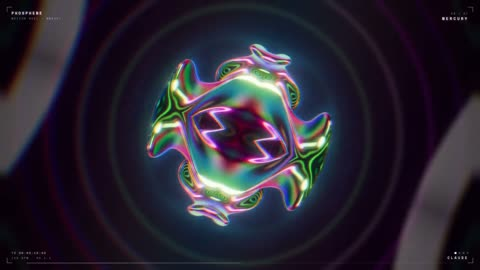

[← 返回图库](../browse/motion.md) · [English](2103563538828832979.en.md)

# 虹彩形体与环形空间的迷幻动效

**[monokern · @monokern](https://x.com/monokern)** · 短动效 · 20s

> 发现池 · 来源已核对，编目资料待完善。

**[▶ 打开画廊播放](https://guanmo-ai.github.io/awesome-ai-motion/#case-2103563538828832979)** · [作者原帖](https://x.com/monokern/status/2103563538828832979)

点击封面打开画廊播放。

虹彩形体在同心环与深色空间中变形，声音设计与视觉共同形成迷幻短片。

作者已公开指令；本站仅提供原帖入口，不再分发全文或译文。 [查看作者原文](https://x.com/monokern/status/2103563538828832979)

收藏 — · 点赞 — · 浏览 —

## 来源记录

- 作品原帖: [@monokern](https://x.com/monokern/status/2103563538828832979) · 2026-09-25T19:13:24+00:00
- 模型归因: Claude Opus 5.5 · [作者说明](https://x.com/monokern/status/2103563538828832979)
- 提示词出处: [作者原帖](https://x.com/monokern/status/2103563538828832979) · 2026-11-02 09:52 UTC
- 封面来源: [原帖封面来源](https://x.com/monokern/status/2103563538828832979) · 10.03s
- 互动快照: [X 原帖](https://x.com/monokern/status/2103563538828832979) · 2026-11-02 09:13 UTC
- 画廊原视频: [原帖媒体记录](https://x.com/monokern/status/2103563538828832979) · 2026-11-02 09:52 UTC · 已核对原帖媒体对应与媒体响应；外部引用，不重新上传

模型依据来自作者自述，未独立重跑提示词，也未对音画作统一质量评级。视频引用作者原帖媒体，未由本站重新上传，转载许可未确认。
