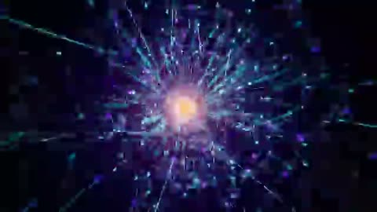

[← Back to gallery](../browse/music.en.md) · [简体中文](2103567118599893113.md)

# A Glowing Core and Spatial Tunnel Sequence

**[AndrewOnXYZ · @AndrewOnXYZ](https://x.com/AndrewOnXYZ)** · Music & lyrics · 223s

> Discovery pool · Source verified; catalog details being completed.

**[▶ Open gallery to play](https://guanmo-ai.github.io/awesome-ai-motion/?lang=en#case-2103567118599893113)** · [Original post](https://x.com/AndrewOnXYZ/status/2103567118599893113)

Click the cover to open the gallery and play.

Luminous nodes, particles and tunnels form abstract visuals through continuous camera motion and color changes.

No public prompt has been verified. [View the original post](https://x.com/AndrewOnXYZ/status/2103567118599893113)

Bookmarks 81 · Likes 129 · Views 6,574

## Source record

- Original post: [@AndrewOnXYZ](https://x.com/AndrewOnXYZ/status/2103567118599893113) · 2026-09-25T19:27:38+00:00
- Model attribution: Opus 5.5 · [Creator’s statement](https://x.com/AndrewOnXYZ/status/2103567118599893113)
- Prompt lookup: [Creator post](https://x.com/AndrewOnXYZ/status/2103567118599893113) · 2026-10-19 09:24 UTC
- Cover source: [Original cover source](https://x.com/AndrewOnXYZ/status/2103567118599893113) · 44.67s
- Metrics snapshot: [Original X post](https://x.com/AndrewOnXYZ/status/2103567118599893113) · 2026-10-19 09:24 UTC
- Gallery video source: [Original post media record](https://x.com/AndrewOnXYZ/status/2103567118599893113) · 2026-10-19 09:24 UTC · Post/media correspondence and media response checked; external reference, no re-upload

Model attribution is based on creator statements. Prompts have not been independently rerun; sound and visuals have not received a uniform quality rating. Videos reference original post media, not our uploads; redistribution permission has not been verified.
