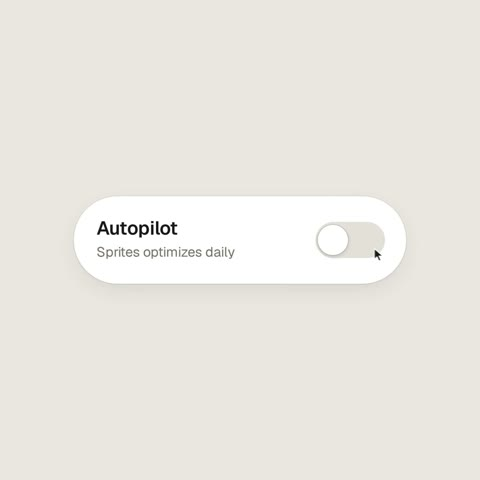

[← Back to gallery](../browse/product.en.md) · [简体中文](2103571096549433425.md)

# A Sprites Promo in Continuous Interface Morphs

**[Anna Chernikova · @AnnaCher\_\_\_](https://x.com/AnnaCher___)** · Product & marketing · 42s

> Discovery pool · Source verified; catalog details being completed.

**[▶ Open gallery to play](https://guanmo-ai.github.io/awesome-ai-motion/?lang=en#case-2103571096549433425)** · [Original post](https://x.com/AnnaCher___/status/2103571096549433425)

Click the cover to open the gallery and play.

Buttons, toggles, loading states and interface elements transform within one continuous shape.

The creator has shared instructions; this catalog links to the source without redistributing the full text or translation. [Read the creator’s original](https://x.com/AnnaCher___/status/2103571098638152174)

Bookmarks — · Likes — · Views —

## Source record

- Original post: [@AnnaCher\_\_\_](https://x.com/AnnaCher___/status/2103571096549433425) · 2026-09-25T19:43:26+00:00
- Model attribution: Claude Opus 5.5 · [Creator’s statement](https://x.com/AnnaCher___/status/2103571096549433425)
- Prompt source: [Creator post](https://x.com/AnnaCher___/status/2103571098638152174) · 2026-11-02 15:38 UTC
- Cover source: [Original cover source](https://x.com/AnnaCher___/status/2103571096549433425) · 8.42s
- Metrics snapshot: [Original X post](https://x.com/AnnaCher___/status/2103571096549433425) · 2026-11-02 15:11 UTC
- Gallery video source: [Original post media record](https://x.com/AnnaCher___/status/2103571096549433425) · 2026-11-02 15:38 UTC · Post/media correspondence and media response checked; external reference, no re-upload

Model attribution is based on creator statements. Prompts have not been independently rerun; sound and visuals have not received a uniform quality rating. Videos reference original post media, not our uploads; redistribution permission has not been verified.
