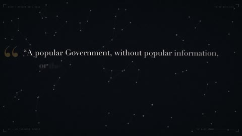

[← Back to gallery](../browse/motion.en.md) · [简体中文](2103606498928808196.md)

# Sixty Seconds of Quotes, Stars and Lines

**[Christopher J. DiMarco · @chrisjdimarco](https://x.com/chrisjdimarco)** · Motion design · 60s

> Discovery pool · Source verified; catalog details being completed.

**[▶ Open gallery to play](https://guanmo-ai.github.io/awesome-ai-motion/?lang=en#case-2103606498928808196)** · [Original post](https://x.com/chrisjdimarco/status/2103606498928808196)

Click the cover to open the gallery and play.

Quote layouts, star-like points and negative space alternate in a themed motion experiment.

No public prompt has been verified. [View the original post](https://x.com/chrisjdimarco/status/2103606498928808196)

Bookmarks — · Likes — · Views —

## Source record

- Original post: [@chrisjdimarco](https://x.com/chrisjdimarco/status/2103606498928808196) · 2026-09-25T22:04:07+00:00
- Model attribution: Claude Opus 5.5 · [Creator’s statement](https://x.com/chrisjdimarco/status/2103606498928808196)
- Prompt lookup: [Creator post](https://x.com/chrisjdimarco/status/2103606498928808196) · 2026-11-02 09:52 UTC
- Cover source: [Original cover source](https://x.com/chrisjdimarco/status/2103606498928808196) · 12.01s
- Metrics snapshot: [Original X post](https://x.com/chrisjdimarco/status/2103606498928808196) · 2026-11-02 09:13 UTC
- Gallery video source: [Original post media record](https://x.com/chrisjdimarco/status/2103606498928808196) · 2026-11-02 09:52 UTC · Post/media correspondence and media response checked; external reference, no re-upload

Model attribution is based on creator statements. Prompts have not been independently rerun; sound and visuals have not received a uniform quality rating. Videos reference original post media, not our uploads; redistribution permission has not been verified.
