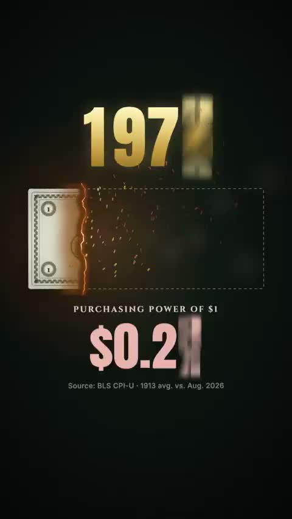

[← Back to gallery](../browse/motion.en.md) · [简体中文](2103617085402407181.md)

# A Fifteen-Second Typography Film about Purchasing Power

**[Connor Boyack 📚 · @cboyack](https://x.com/cboyack)** · Motion design · 15s

> Discovery pool · Source verified; catalog details being completed.

**[▶ Open gallery to play](https://guanmo-ai.github.io/awesome-ai-motion/?lang=en#case-2103617085402407181)** · [Original post](https://x.com/cboyack/status/2103617085402407181)

Click the cover to open the gallery and play.

Dates, currency symbols and large slogans shift quickly, using numbers and dark typography to present the creator's monetary-policy viewpoint.

No public prompt has been verified. [View the original post](https://x.com/cboyack/status/2103617085402407181)

Bookmarks 27 · Likes 115 · Views 7,083

## Source record

- Original post: [@cboyack](https://x.com/cboyack/status/2103617085402407181) · 2026-09-25T22:46:11+00:00
- Model attribution: Claude Opus 5.5 · [Creator’s statement](https://x.com/cboyack/status/2103617085402407181)
- Prompt lookup: [Creator post](https://x.com/cboyack/status/2103617085402407181) · 2026-10-23 05:30 UTC
- Cover source: [Original cover source](https://x.com/cboyack/status/2103617085402407181) · 3s
- Metrics snapshot: [Original X post](https://x.com/cboyack/status/2103617085402407181) · 2026-10-23 05:30 UTC
- Gallery video source: [Original post media record](https://x.com/cboyack/status/2103617085402407181) · 2026-10-23 05:30 UTC · Post/media correspondence and media response checked; external reference, no re-upload

Model attribution is based on creator statements. Prompts have not been independently rerun; sound and visuals have not received a uniform quality rating. Videos reference original post media, not our uploads; redistribution permission has not been verified.
