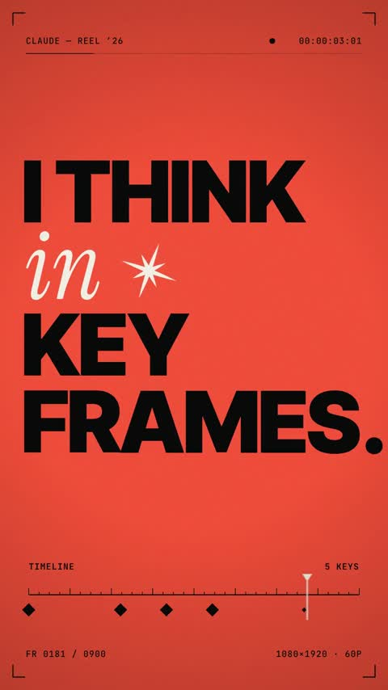

[← Back to gallery](../browse/motion.en.md) · [简体中文](2103627106240602357.md)

# Vertical Keyframe and Geometry Reel

**[レム⚛️Cosmos🥷 · @lemcosmos](https://x.com/lemcosmos)** · Motion design · 15s

> Discovery pool · Source verified; catalog details being completed.

**[▶ Open gallery to play](https://guanmo-ai.github.io/awesome-ai-motion/?lang=en#case-2103627106240602357)** · [Original post](https://x.com/lemcosmos/status/2103627106240602357)

Click the cover to open the gallery and play.

Bold typography and colorful geometric patterns switch across a vertical frame.

The creator has shared instructions; this catalog links to the source without redistributing the full text or translation. [Read the creator’s original](https://x.com/lemcosmos/status/2103627106240602357)

Bookmarks — · Likes — · Views —

## Source record

- Original post: [@lemcosmos](https://x.com/lemcosmos/status/2103627106240602357) · 2026-09-25T23:26:00+00:00
- Model attribution: Claude Opus 5.5 · [Creator’s statement](https://x.com/lemcosmos/status/2103627106240602357)
- Prompt source: [Creator post](https://x.com/lemcosmos/status/2103627106240602357) · 2026-11-03 09:18 UTC
- Cover source: [Original cover source](https://x.com/lemcosmos/status/2103627106240602357) · 3.01s
- Metrics snapshot: [Original X post](https://x.com/lemcosmos/status/2103627106240602357) · 2026-11-03 08:42 UTC
- Gallery video source: [Original post media record](https://x.com/lemcosmos/status/2103627106240602357) · 2026-11-03 09:18 UTC · Post/media correspondence and media response checked; external reference, no re-upload

Model attribution is based on creator statements. Prompts have not been independently rerun; sound and visuals have not received a uniform quality rating. Videos reference original post media, not our uploads; redistribution permission has not been verified.
