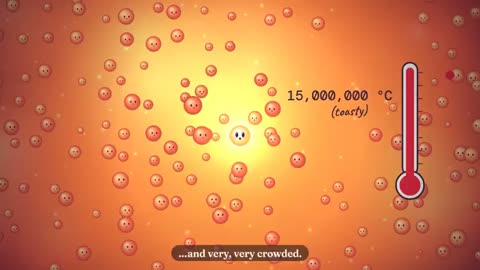

[← Back to gallery](../browse/education.en.md) · [简体中文](2103629247751618782.md)

# How Particles in the Sun Reach Space

**[AstroTheWizard · @AstroTheWizard](https://x.com/AstroTheWizard)** · Education & explainers · 60s

> Discovery pool · Source verified; catalog details being completed.

**[▶ Open gallery to play](https://guanmo-ai.github.io/awesome-ai-motion/?lang=en#case-2103629247751618782)** · [Original post](https://x.com/AstroTheWizard/status/2103629247751618782)

Click the cover to open the gallery and play.

Cartoon particles, a thermometer and paths through space connect the Sun's interior with a broader science story.

No public prompt has been verified. [View the original post](https://x.com/AstroTheWizard/status/2103629247751618782)

Bookmarks 12 · Likes 19 · Views 3,718

## Source record

- Original post: [@AstroTheWizard](https://x.com/AstroTheWizard/status/2103629247751618782) · 2026-09-25T23:34:30+00:00
- Model attribution: Claude Opus 5.5 · [Creator’s statement](https://x.com/AstroTheWizard/status/2103629247751618782)
- Prompt lookup: [Creator post](https://x.com/AstroTheWizard/status/2103629247751618782) · 2026-10-23 05:30 UTC
- Cover source: [Original cover source](https://x.com/AstroTheWizard/status/2103629247751618782) · 12s
- Metrics snapshot: [Original X post](https://x.com/AstroTheWizard/status/2103629247751618782) · 2026-10-23 05:30 UTC
- Gallery video source: [Original post media record](https://x.com/AstroTheWizard/status/2103629247751618782) · 2026-10-23 05:30 UTC · Post/media correspondence and media response checked; external reference, no re-upload

Model attribution is based on creator statements. Prompts have not been independently rerun; sound and visuals have not received a uniform quality rating. Videos reference original post media, not our uploads; redistribution permission has not been verified.
