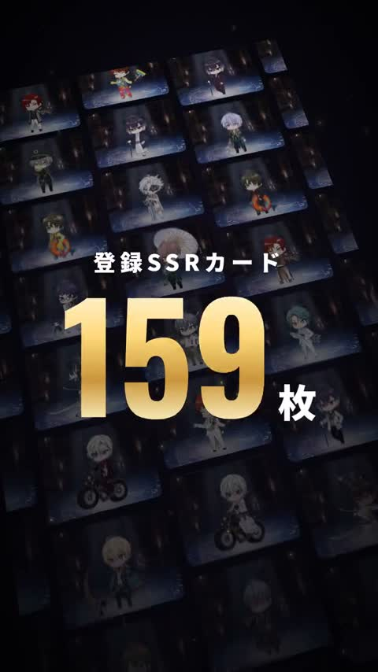

[← Back to gallery](../browse/product.en.md) · [简体中文](2103637250420658403.md)

# A Fan-Site Promo in Cards and Characters

**[猫の手も借りたい · @nek0n0tem0](https://x.com/nek0n0tem0)** · Product & marketing · 15s

> Discovery pool · Source verified; catalog details being completed.

**[▶ Open gallery to play](https://guanmo-ai.github.io/awesome-ai-motion/?lang=en#case-2103637250420658403)** · [Original post](https://x.com/nek0n0tem0/status/2103637250420658403)

Click the cover to open the gallery and play.

Card walls, anime character imagery and type transitions introduce a fan site with separately generated voice and music.

No public prompt has been verified. [View the original post](https://x.com/nek0n0tem0/status/2103637250420658403)

Bookmarks — · Likes — · Views —

## Source record

- Original post: [@nek0n0tem0](https://x.com/nek0n0tem0/status/2103637250420658403) · 2026-09-26T00:06:18+00:00
- Model attribution: Claude Opus 5.5 · [Creator’s statement](https://x.com/nek0n0tem0/status/2103637250420658403)
- Prompt lookup: [Creator post](https://x.com/nek0n0tem0/status/2103637250420658403) · 2026-11-02 15:38 UTC
- Cover source: [Original cover source](https://x.com/nek0n0tem0/status/2103637250420658403) · 3.01s
- Metrics snapshot: [Original X post](https://x.com/nek0n0tem0/status/2103637250420658403) · 2026-11-02 15:08 UTC
- Gallery video source: [Original post media record](https://x.com/nek0n0tem0/status/2103637250420658403) · 2026-11-02 15:38 UTC · Post/media correspondence and media response checked; external reference, no re-upload

Model attribution is based on creator statements. Prompts have not been independently rerun; sound and visuals have not received a uniform quality rating. Videos reference original post media, not our uploads; redistribution permission has not been verified.
