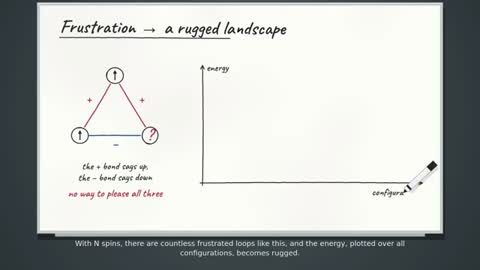

[← 返回图库](../browse/education.md) · [English](2103667481139441895.en.md)

# 白板上的副本对称性破缺

**[Dersu · @tak3sh8](https://x.com/tak3sh8)** · 知识讲解 · 308s

> 发现池 · 来源已核对，编目资料待完善。

**[▶ 打开画廊播放](https://guanmo-ai.github.io/awesome-ai-motion/#case-2103667481139441895)** · [作者原帖](https://x.com/tak3sh8/status/2103667481139441895)

点击封面打开画廊播放。

自旋示意、能量曲线和递归分块图在白板上逐步绘制，用手写标题和箭头组织抽象概念。

作者已公开指令；本站仅提供原帖入口，不再分发全文或译文。 [查看作者原文](https://x.com/tak3sh8/status/2103667481139441895)

收藏 10 · 点赞 19 · 浏览 1,320

## 来源记录

- 作品原帖: [@tak3sh8](https://x.com/tak3sh8/status/2103667481139441895) · 2026-09-26T02:06:26+00:00
- 模型归因: Claude Opus 5.5 · [作者说明](https://x.com/tak3sh8/status/2103667481139441895)
- 提示词出处: [作者原帖](https://x.com/tak3sh8/status/2103667481139441895) · 2026-10-23 05:30 UTC
- 封面来源: [原帖封面来源](https://x.com/tak3sh8/status/2103667481139441895) · 61.68s
- 互动快照: [X 原帖](https://x.com/tak3sh8/status/2103667481139441895) · 2026-10-23 05:30 UTC
- 画廊原视频: [原帖媒体记录](https://x.com/tak3sh8/status/2103667481139441895) · 2026-10-23 05:30 UTC · 已核对原帖媒体对应与媒体响应；外部引用，不重新上传

模型依据来自作者自述，未独立重跑提示词，也未对音画作统一质量评级。视频引用作者原帖媒体，未由本站重新上传，转载许可未确认。
