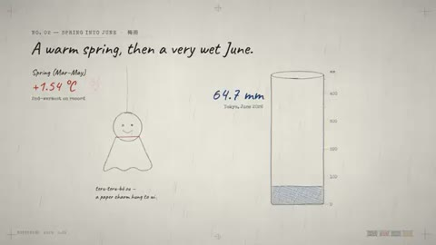

[← Back to gallery](../browse/education.en.md) · [简体中文](2103678647777230877.md)

# A Hand-Drawn Explainer of Japan’s Summer Weather

**[Rafael Mendiola · @GroundControl](https://x.com/GroundControl)** · Education & explainers · 180s

> Discovery pool · Source verified; catalog details being completed.

**[▶ Open gallery to play](https://guanmo-ai.github.io/awesome-ai-motion/?lang=en#case-2103678647777230877)** · [Original post](https://x.com/GroundControl/status/2103678647777230877)

Click the cover to open the gallery and play.

Handwritten titles, a rainfall vessel, temperature figures and tally marks explain summer weather, using figures presented by the creator.

No public prompt has been verified. [View the original post](https://x.com/GroundControl/status/2103678647777230877)

Bookmarks 3 · Likes 5 · Views 487

## Source record

- Original post: [@GroundControl](https://x.com/GroundControl/status/2103678647777230877) · 2026-09-26T02:50:48+00:00
- Model attribution: Opus 5.5 · [Creator’s statement](https://x.com/GroundControl/status/2103678647777230877)
- Prompt lookup: [Creator post](https://x.com/GroundControl/status/2103678647777230877) · 2026-10-19 08:34 UTC
- Cover source: [Original cover source](https://x.com/GroundControl/status/2103678647777230877) · 36s
- Metrics snapshot: [Original X post](https://x.com/GroundControl/status/2103678647777230877) · 2026-10-19 08:34 UTC
- Gallery video source: [Original post media record](https://x.com/GroundControl/status/2103678647777230877) · 2026-10-19 08:34 UTC · Post/media correspondence and media response checked; external reference, no re-upload

Model attribution is based on creator statements. Prompts have not been independently rerun; sound and visuals have not received a uniform quality rating. Videos reference original post media, not our uploads; redistribution permission has not been verified.
