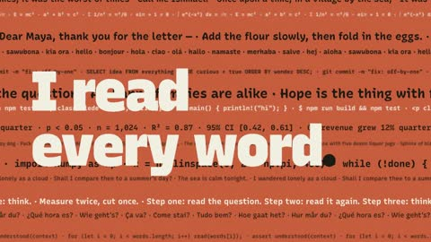

[← Back to gallery](../browse/motion.en.md) · [简体中文](2103711849703477361.md)

# Introducing Opus with Dimensional Bold Type

**[Sourav Bhar · @souravbhar871](https://x.com/souravbhar871)** · Motion design · 10s

> Discovery pool · Source verified; catalog details being completed.

**[▶ Open gallery to play](https://guanmo-ai.github.io/awesome-ai-motion/?lang=en#case-2103711849703477361)** · [Original post](https://x.com/souravbhar871/status/2103711849703477361)

Click the cover to open the gallery and play.

Large serif type emerges from dense small text as heavy letter blocks rotate and compress in an orange-and-black model introduction.

The creator has shared instructions; this catalog links to the source without redistributing the full text or translation. [Read the creator’s original](https://x.com/souravbhar871/status/2103711849703477361)

Bookmarks — · Likes 0 · Views —

## Source record

- Original post: [@souravbhar871](https://x.com/souravbhar871/status/2103711849703477361) · 2026-09-26T05:02:44+00:00
- Model attribution: Claude Opus 5.5 · [Creator’s statement](https://x.com/souravbhar871/status/2103711849703477361)
- Prompt source: [Creator post](https://x.com/souravbhar871/status/2103711849703477361) · 2026-10-26 16:20 UTC
- Cover source: [Original cover source](https://x.com/souravbhar871/status/2103711849703477361) · 2s
- Metrics snapshot: [Original X post](https://x.com/souravbhar871/status/2103711849703477361) · 2026-10-26 15:53 UTC
- Gallery video source: [Original post media record](https://x.com/souravbhar871/status/2103711849703477361) · 2026-10-26 16:20 UTC · Post/media correspondence and media response checked; external reference, no re-upload

Model attribution is based on creator statements. Prompts have not been independently rerun; sound and visuals have not received a uniform quality rating. Videos reference original post media, not our uploads; redistribution permission has not been verified.
