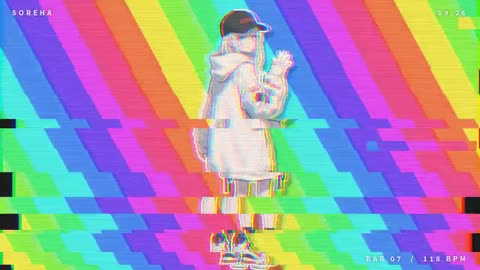

[← Back to gallery](../browse/music.en.md) · [简体中文](2103722556918464968.md)

# Japanese-Style Glitch Character MV

**[Good FortuneX · @pound75423](https://x.com/pound75423)** · Music & lyrics · 64s

> Discovery pool · Source verified; catalog details being completed.

**[▶ Open gallery to play](https://guanmo-ai.github.io/awesome-ai-motion/?lang=en#case-2103722556918464968)** · [Original post](https://x.com/pound75423/status/2103722556918464968)

Click the cover to open the gallery and play.

Character stickers, rainbow backgrounds and text fragments form a glitch-and-mirror music video.

The creator has shared instructions; this catalog links to the source without redistributing the full text or translation. [Read the creator’s original](https://x.com/pound75423/status/2103722556918464968)

Bookmarks — · Likes — · Views —

## Source record

- Original post: [@pound75423](https://x.com/pound75423/status/2103722556918464968) · 2026-09-26T05:45:17+00:00
- Model attribution: Claude Opus 5.5 · [Creator’s statement](https://x.com/pound75423/status/2103722556918464968)
- Prompt source: [Creator post](https://x.com/pound75423/status/2103722556918464968) · 2026-11-03 09:18 UTC
- Cover source: [Original cover source](https://x.com/pound75423/status/2103722556918464968) · 12.79s
- Metrics snapshot: [Original X post](https://x.com/pound75423/status/2103722556918464968) · 2026-11-03 08:38 UTC
- Gallery video source: [Original post media record](https://x.com/pound75423/status/2103722556918464968) · 2026-11-03 09:18 UTC · Post/media correspondence and media response checked; external reference, no re-upload

Model attribution is based on creator statements. Prompts have not been independently rerun; sound and visuals have not received a uniform quality rating. Videos reference original post media, not our uploads; redistribution permission has not been verified.
