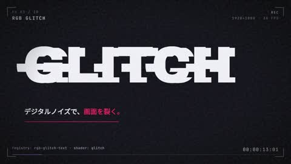

[← Back to gallery](../browse/motion.en.md) · [简体中文](2103738032847552662.md)

# Glass, Metal and Portal Effects

**[Maki@Sunwood AI Labs. · @hAru\_mAki\_ch](https://x.com/hAru_mAki_ch)** · Motion design · 65s

> Discovery pool · Source verified; catalog details being completed.

**[▶ Open gallery to play](https://guanmo-ai.github.io/awesome-ai-motion/?lang=en#case-2103738032847552662)** · [Original post](https://x.com/hAru_mAki_ch/status/2103738032847552662)

Click the cover to open the gallery and play.

Glass, metallic treatments and portal graphics form a HyperFrames and Paper Shaders effects reel.

No public prompt has been verified. [View the original post](https://x.com/hAru_mAki_ch/status/2103738032847552662)

Bookmarks — · Likes — · Views —

## Source record

- Original post: [@hAru\_mAki\_ch](https://x.com/hAru_mAki_ch/status/2103738032847552662) · 2026-09-26T06:46:47+00:00
- Model attribution: Claude Opus 5.5 · [Creator’s statement](https://x.com/hAru_mAki_ch/status/2103738032847552662)
- Prompt lookup: [Creator post](https://x.com/hAru_mAki_ch/status/2103738032847552662) · 2026-11-02 09:52 UTC
- Cover source: [Original cover source](https://x.com/hAru_mAki_ch/status/2103738032847552662) · 13.01s
- Metrics snapshot: [Original X post](https://x.com/hAru_mAki_ch/status/2103738032847552662) · 2026-11-02 09:18 UTC
- Gallery video source: [Original post media record](https://x.com/hAru_mAki_ch/status/2103738032847552662) · 2026-11-02 09:52 UTC · Post/media correspondence and media response checked; external reference, no re-upload

Model attribution is based on creator statements. Prompts have not been independently rerun; sound and visuals have not received a uniform quality rating. Videos reference original post media, not our uploads; redistribution permission has not been verified.
